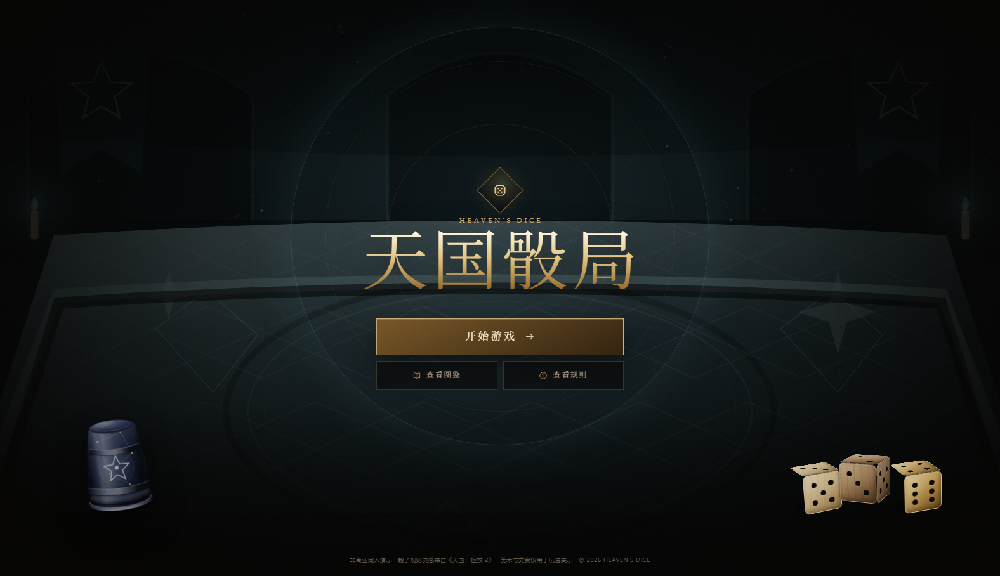
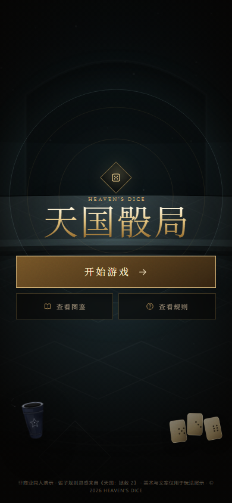
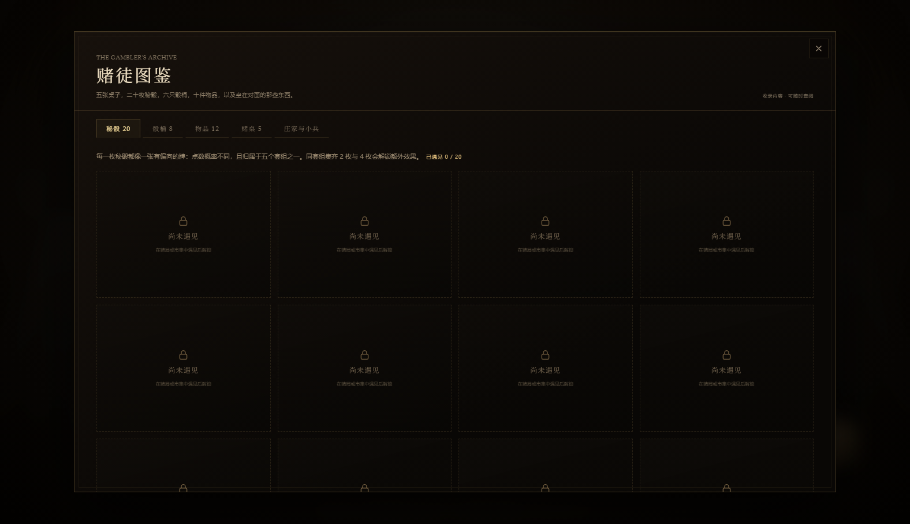
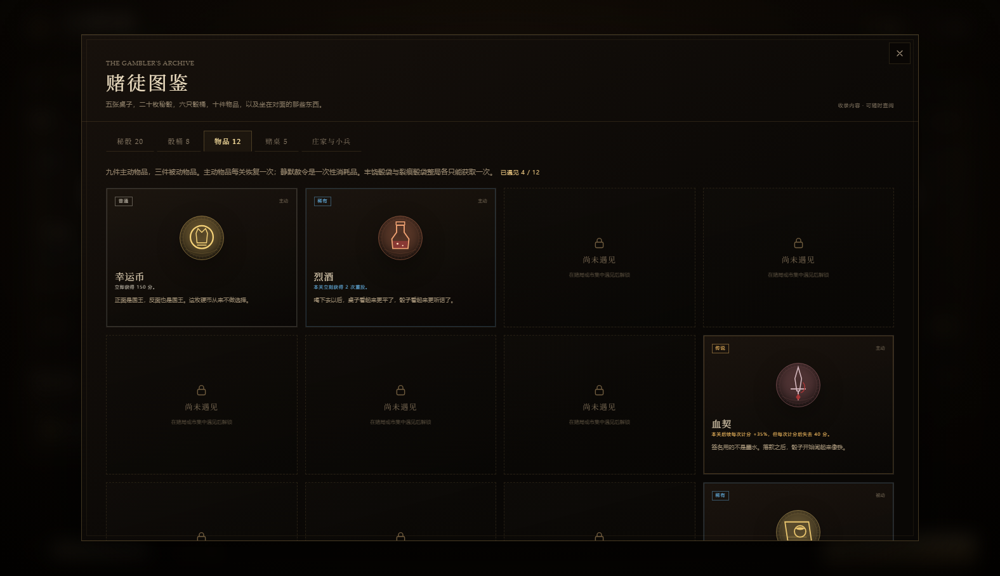
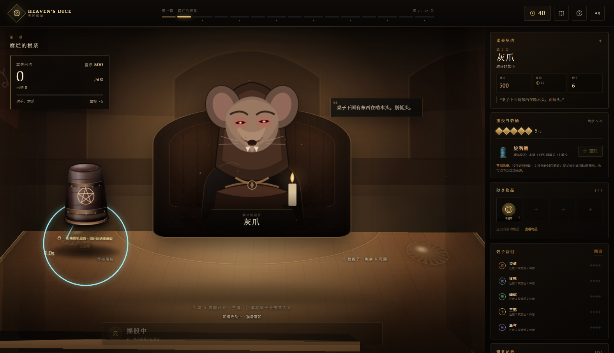
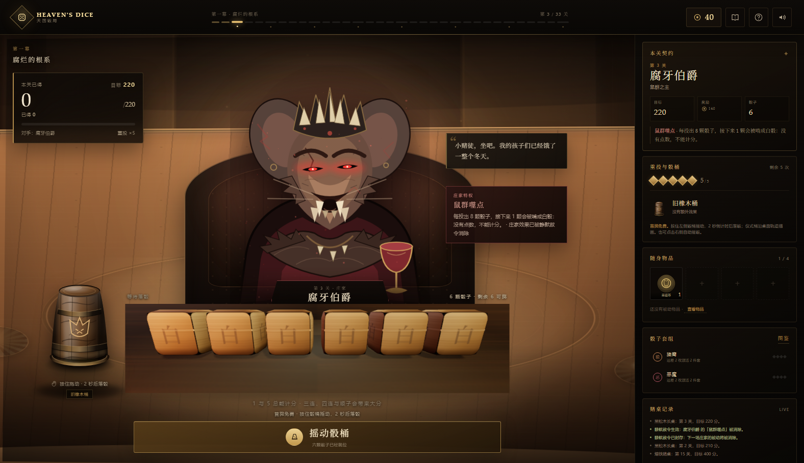

# 天国骰局 · Heaven's Dice

> 骰子落下之前，命运只是一句空话。

一款以《天国：拯救 2》骰子规则为骨架的**肉鸽网页游戏**。你坐在长桌这一侧，用六颗骰子、五次重投和一件件不太干净的赌具，去够到每关的目标分数；八位庄家分别在 3、6、10、14、18、23、28、33 关落座，之间的小兵关越排越长。三十三关，五张桌子，八位庄家——赢下他们，天就亮了。

项目为**原生 HTML / CSS / JavaScript**，无框架、无构建步骤、无外部运行时依赖；所有插画与图标都是仓库内的原创 SVG。

源码仓库：`git@github.com:fangzipei/heaven-s-dice.git`


## 线上地址

- 当前发布：<http://221.228.10.210:9999/heavens-dice/>
- 健康检查：<http://221.228.10.210:9999/heavens-dice/healthz>
- 发布与更新说明：[deploy/README.md](deploy/README.md)

这台服务器的 80/443 在阿里云安全组未放行，所以先挂在已放行的 9999 端口独立路径下，不改动同端口原有站点。80 端口的 Nginx 站点也已配置好；在安全组放行 80/TCP 后，可直接访问裸 IP。

## 首页与图鉴

首页只保留主题图、logo、三个按钮和底部小字声明：

- **开始游戏**：先询问是否进入图解教程，然后入座。
- **查看图鉴**：骰子、骰桶、物品、赌桌、庄家与小兵。
- **查看规则**：打开完整的图解教程。



手机端首页：



### 图鉴解锁

物品、骰桶和骰子只有在**局内或市集中遇见过**之后才会显示名称、插画、概率与说明：

- 开局后解锁当前骰袋、当前骰桶和随身物品。
- 市集里刷新出来的货品，即使没有购买，只要出现过就会解锁。
- 解锁记录保存在浏览器 `localStorage`，跨局、刷新页面后仍然保留。
- 未遇见的条目只显示锁定占位，不显示名称、属性或概率。

| 未遇见 | 已解锁 |
|---|---|
|  |  |

## 图解教程

点击「开始游戏」会先询问是否进入教程，也可以从首页「查看规则」直接打开。

教程用骰子图逐条解释：

- 单颗 1 / 5 的计分；
- 三个相同点数（三连）的基础分，例如 **三个 3 = 300**；
- 四个、五个、六个相同点数的倍率，例如 **四个 3 = 600（300 × 2）**、五个 3 = 1,200、六个 3 = 2,400；
- 1 点的特例、顺子、混合组合与“选中骰必须全部合法”；
- 已得 / 本轮未计入、掷空作废、全骰、达标后手动下一关；
- 骰桶、20 枚秘骰、套组、物品、市集和八位庄家的桌规。

| 开局询问 | 计分图解 |
|---|---|
|  |  |

手机端教程（390px 宽）：


| 对局 · 3D 场景 | 3D 骰子特写 |
|---|---|
|  |  |
| **骰桶倒扣** | **重投前慢转** |
|  |  |
| **已得 / 本轮未计入** | **计分后选择重投方式** |
|  |  |
| **掷空作废** | **目标达成后继续得分** |
|  |  |
| **骰桶全桌拖动** | **五芒星仪式** |
|  |  |
| **桌面五芒星轨迹** | **桌面顺时针圆轨迹** |
|  |  |
| **赌徒图鉴** | **市集** |
|  |  |
| **终局赌桌** | **庄家登场** |
|  |  |

线上运行：


手机端选中骰子后的计分按钮（固定在底部安全区上方）：


---

## 3D 场景

对局场景不是一张预先画好的平面背景：

- 房间的后墙、侧墙、地面、桌面和对手座椅都由 **CSS 3D transforms** 组成，带有真实透视与深度排序。
- 鼠标在场景内移动时，房间与桌面会产生很轻的**视差摆动**；对手、骰桶和骰子随之位移，UI 保持稳定。
- 重投前，桌上可读的骰子会先缓慢自转（全部重投时六颗一起转）；按住骰桶摇动后，骰子逐颗飞进桶里，并开始 **2 秒倒计时**，倒计时结束自动扶正落骰。
- 装备五芒桶或旋涡桶时，按住骰桶会在桌面上显示金色轨迹（五芒星 / 顺时针圆）；沿着轨迹拖动骰桶描画，轨迹覆盖率或方向偏差过大时仪式失败，但仍会正常落骰。
- 选骰高亮：选中骰子会抬高、金色描边、底座光晕并亮起右上角 ✓，未选骰子自动退暗；托盘上方同步显示“已选 N 颗”。
- 骰子是真正的**六面立方体**：每个面都有独立点数，落定时结果面朝向镜头；投掷时整颗骰子翻滚。
- 点数是标准骰子布局：**2 点与 3 点斜向排列**，4 点四角，5 点四角加中心，6 点两列。三点不会再排成一条直线。
- 桌面材质通过主题变量切换，木头、青石、黑铁、黄金、钻石各自有不同色阶、纹理和桌面光。

---

## 快速开始

环境：Node.js 20+。

```bash
# 在项目根目录
npm run dev
# 打开 http://127.0.0.1:4173
```

也可以直接使用任意静态服务器托管项目根目录。不能双击 `index.html` 打开，因为项目使用了 ES Modules，浏览器会拦截 `file://` 下的模块加载。

运行测试：

```bash
npm test
```

平衡模拟：

```bash
npm run simulate      # 500 局全流程模拟
node tools/balance.mjs 400
```

骰子期望分数评估（单颗 / 2 件 / 4 件 / 配桶的关卡得分期望差，含商店出货分布）：

```bash
npm run dice:ev
node tools/dice-ev.mjs --trials=600 --level=8
```

---

## 玩法

- **目标**：每关达到目标分数后不会自动结束，可以继续得分；准备好后点击左上角「下一关」（终局为「查看结局」），再进入市集或结局。共 33 关。
- **骰子**：默认 6 颗，默认 5 次重投。第一次投掷免费。
- **流程**：投掷 → 点击选择要计分的骰子 → 选择：
  1. **计分并继续**：选中骰计分并移出，重投剩余骰子；
  2. **计分并重投**：选中骰计分并移出，全部六颗骰子重新投。
  - 两种选择各消耗 1 次重投。
- **计分后不自动重投**：计分动作结算完成后会停在“选择重投方式”，不会替玩家自动掷下一次。此时可以拖动左侧骰桶自己摇，或点「系统重投」/右侧自动按钮让系统代摇。
- **本轮与掷空**：继续/重投得到的分数先进入“本轮未计入”池；下一次投掷若仍存在合法计分组合，这笔分数转为“已得”，若完全没有可计分组合，则本轮这笔分数全部作废，此前的“已得”保留。左上角会拆开显示“已得 / 本轮未计入”，掷空时给出红色作废提示。
- **全骰（Hot Dice）**：如果六颗骰子全部被计分，六颗骰子全部归位，可以免费重投全部骰子，不消耗重投次数；本轮分数仍然处于未计入状态。
- **无重投次数**：选择「计分并结算」；若已达到目标，可以继续停留或点击下一关，否则本关失败。
- **失败**：重投耗尽且分数仍不足目标，本关失败。可以**卷土重来**：保留骰袋、骰桶与物品，失去一半银币。
- **庄家徽记**：每击败一位庄家，后续关卡的重投上限永久 +1（基础仍是 5 次）。
- **门房赠礼**：开局自带一枚主动物品「幸运币」，每关可花费一次，立即 +150 分。

### 过关奖金：收手换钱与超额赏金

结算发生在点击「下一关」的那一刻，所以“什么时候收手”本身是一笔账。

| 来源 | 规则 |
|---|---|
| 基础奖励 | 每关固定值（45 ~ 185 银币，见关卡表） |
| 剩余重投 | 每剩 **1 次未使用的重投 = 8 银币**（5 次全剩 = +40） |
| 超额赏金 | 得分达到目标的 **1.5 倍 +25 / 2 倍 +60 / 3 倍 +140**，只取达到的最高一档，不叠加 |
| 镀金袖扣 | 每关胜利 +15（被动物品，可与上面叠加） |

- 奖励在 `advanceLevel` → `awardLevel` 里一次性结算，明细写进 `levelReward.bonuses`，胜利面板逐条列出。
- 达标瞬间、以及每跨过一个超额档位，战报都会提示“现在收手能拿多少”。
- 左上角「胜利奖励」实时等于**此刻收手的总收入**（基础 + 重投折价 + 已达成的倍数档），悬停显示明细，因此继续加注的机会成本是可见的。
- 常量集中在 `src/data.js`：`REROLL_REFUND` 与 `OVERSHOOT_TIERS`；`overshootTier(score, target)` 与 `cashOutValue(state)` 共用同一套判定，界面预览与实际结算不会漂移。

### 计分规则（《天国：拯救 2》/ Farkle）

| 组合 | 分数 |
|---|---:|
| 单颗 1 | 100 |
| 单颗 5 | 50 |
| 三连 1 | 1000 |
| 三连 2–6 | 点数 × 100 |
| 四连 | 三连 × 2 |
| 五连 | 三连 × 4 |
| 六连 | 三连 × 8 |
| 顺子 1–2–3–4–5 | 500 |
| 顺子 2–3–4–5–6 | 750 |
| 通天顺 1–6 | 1500 |

一次计分必须把所选的每一颗骰子都纳入合法组合。1 与 5 可以单颗计分；其他点数至少三颗。系统会在合法拆分中自动取最高分。

每次计分先挂入“本轮未计入”；下一次投掷若仍有合法计分组合，自动转入“已得”，若掷空则这笔挂账作废。已得分数不会因后来的掷空回退。

---

## 操作

| 操作 | 方式 |
|---|---|
| 手动摇骰 | 按住左侧骰桶拖动；拖动范围覆盖整张桌面，2 秒倒计时后自动落骰 |
| 仪式轨迹 | 五芒桶 / 旋涡桶按住后显示桌面轨迹，沿轨迹画；偏差过大则仪式失败 |
| 手机端计分 | 选中骰子后，底部安全区上方固定出现「计分并继续 / 计分并重投」两个按钮 |
| 自动摇骰 | 点击右侧「自动摇骰」或按空格 |
| 选择骰子 | 点击骰子；可多选 |
| 计分并继续 | 底部左侧按钮 / 数字键 `1`（重投剩余骰子） |
| 计分并重投 | 底部右侧按钮 / 数字键 `2`（全部六颗重新投） |
| 计分并结算 | 无重投次数时出现的单一按钮（也可按 `1`） |
| 使用物品 | 右侧「随身物品」栏 |
| 画阵 | 装备仪式骰桶后，也可点击「画阵」使用独立画布 |
| 关闭弹窗 | `Esc` 或右上角关闭 |

鼠标悬停在骰子上可以看到**当前骰桶修正后的六面概率**、稀有度、套组和骰子特性。

---

## 三十三关结构：数值是算出来的，不是抄出来的

八位庄家，每个庄家之前的小兵关**只增不减**：2 / 2 / 3 / 3 / 3 / 4 / 4 / 4。庄家落座于 **3、6、10、14、18、23、28、33** 关，五张桌子平分全部关卡（7 / 7 / 7 / 6 / 6）。

关卡表**没有一行是手写的数字**。`src/data.js` 里只有三样东西：

```js
export const MINION_GAPS = [2, 2, 3, 3, 3, 4, 4, 4];   // 每位庄家前留几个小兵关
export const LEVEL_CURVE = { targetBase: 200, targetGrowth: 1.05,
                             rewardBase: 55, rewardGrowth: 1.055, ... };
// 每位庄家在 BOSS_DEFS 里带着自己的系数：
curve: { target: 1, reward: 1.65 }
```

`buildLevelTable()` 把三者乘起来：目标 = `200 × 1.05^(关-1) × 庄家目标系数`，赏金 = `55 × 1.055^(关-1) × 庄家赏金系数`，都取整到 10 / 5。**加一位庄家只需往 `BOSS_DEFS` 里加一条、在 `MINION_GAPS` 里补一个空档**——关卡总数、庄家关卡号、章节划分、赏金会自己重排。改难度只动系数，改曲线只动 `LEVEL_CURVE`。

| 关卡数 | 目标 | 基础赏金 | 庄家系数 |
|---|---|---|---|
| 33 | 200 → 950 | 55 → 440 | ×1.30 – ×1.65 |

| 关 | 目标 | 基础银币 | 对手 | 桌 | 庄家系数 |
|---:|---:|---:|---|---|---:|
| 1 | 200 | 55 | 灰爪 | 黑松木长桌 | — |
| 2 | 210 | 60 | 灰爪 | 黑松木长桌 | — |
| 3 | 220 | 100 | **腐牙伯爵** | 黑松木长桌 | ×1.65 |
| 4 | 230 | 65 | 灰爪 | 黑松木长桌 | — |
| 5 | 240 | 70 | 灰爪 | 黑松木长桌 | — |
| 6 | 260 | 110 | **石心审判官** | 黑松木长桌 | ×1.50 |
| 7 | 270 | 75 | 灰爪 | 黑松木长桌 | — |
| 8 | 280 | 80 | 石砾 | 灰岩审判桌 | — |
| 9 | 300 | 85 | 石砾 | 灰岩审判桌 | — |
| 10 | 310 | 130 | **铁面铸魂师** | 灰岩审判桌 | ×1.45 |
| 11 | 330 | 95 | 石砾 | 灰岩审判桌 | — |
| 12 | 340 | 100 | 石砾 | 灰岩审判桌 | — |
| 13 | 360 | 105 | 石砾 | 灰岩审判桌 | — |
| 14 | 380 | 155 | **灰烬书记官** | 灰岩审判桌 | ×1.40 |
| 15 | 400 | 115 | 炭手 | 熔铁赌桌 | — |
| 16 | 420 | 125 | 炭手 | 熔铁赌桌 | — |
| 17 | 440 | 130 | 炭手 | 熔铁赌桌 | — |
| 18 | 460 | 185 | **金冠赌王** | 熔铁赌桌 | ×1.35 |
| 19 | 480 | 145 | 炭手 | 熔铁赌桌 | — |
| 20 | 510 | 150 | 炭手 | 熔铁赌桌 | — |
| 21 | 530 | 160 | 炭手 | 熔铁赌桌 | — |
| 22 | 560 | 170 | 鎏金侍从 | 鎏金王庭桌 | — |
| 23 | 590 | 230 | **星辉税吏** | 鎏金王庭桌 | ×1.30 |
| 24 | 610 | 190 | 鎏金侍从 | 鎏金王庭桌 | — |
| 25 | 650 | 200 | 鎏金侍从 | 鎏金王庭桌 | — |
| 26 | 680 | 210 | 鎏金侍从 | 鎏金王庭桌 | — |
| 27 | 710 | 220 | 鎏金侍从 | 鎏金王庭桌 | — |
| 28 | 750 | 350 | **悬秤人** | 棱晶天穹桌 | ×1.50 |
| 29 | 780 | 245 | 棱翼执事 | 棱晶天穹桌 | — |
| 30 | 820 | 260 | 棱翼执事 | 棱晶天穹桌 | — |
| 31 | 860 | 275 | 棱翼执事 | 棱晶天穹桌 | — |
| 32 | 910 | 290 | 棱翼执事 | 棱晶天穹桌 | — |
| 33 | 950 | 440 | **钻石天使** | 棱晶天穹桌 | ×1.45 |

表中的“基础银币”不含剩余重投折价与超额赏金。系数随关卡缓慢收敛（早庄家 ×1.65，后期 ×1.30–1.45）：曲线本身在指数上涨，系数若固定不变，后期赏金会直接爆炸。

目标曲线不是拍脑袋定的：`tools/balance.mjs` 用起手骰袋实测，单关五掷的中位收益约 **400 分**，因此曲线从 200 分起步、每关约 +5%，奖励每关约 +5.5%，始终略快于目标，让构筑能跟上。改完任何数值后跑一次：

```
node tools/balance.mjs 400
```

它会输出每关的**到达率**与**本关通过率**（到达率会随关卡数自然衰减，本关通过率才是难度信号），并标出通过率低于 70% 的关卡与终局余钱。

---

## 八位庄家与特殊效果

庄家的赏金系数不是随手写的：它记在每位庄家的 `curve.reward` 上，结算时会单独摊开告诉你“这一关为什么比隔壁贵”。

| 庄家 | 关卡 | 悬赏系数 | 特殊效果 | 机制 |
|---|---:|---:|---|---|
| **腐牙伯爵** · 鼠群之主 | 3 | ×1.65 | 鼠群噬点 | 每投出 8 颗骰子，接下来 1 颗会被啃成白骰：没有点数，不能计分。 |
| **石心审判官** · 无言法庭 | 6 | ×1.50 | 三证成立 | 只有使用 3 颗及以上骰子的组合才能计分；更小的组合仍可打出，但本次得 0 分。 |
| **铁面铸魂师** · 熔炉之主 | 10 | ×1.45 | 六点回炉 | 所有 6 点骰子被熔毁：不能选择，也不能计分。 |
| **灰烬书记官** · 熔炉的记录员 | 14 | ×1.40 | 不许复写 | 本关不能连续使用同一种骰型；重复上一手的骰型本次得 0 分。 |
| **金冠赌王** · 无冕之王 | 18 | ×1.35 | 只开一桌 | 本关第一次计分会锁定一种骰型；之后只能继续使用同一种骰型，其他骰型得 0 分。 |
| **星辉税吏** · 天穹的收税官 | 23 | ×1.30 | 少一次机会 | 本关重投次数减少 1 次。 |
| **悬秤人** · 未落定之数 | 28 | ×1.50 | 浮筹未决 | 本关所有得分都是漂浮分：计分与重投都不会真正入账，只有离开这张桌子时才结算；一旦掷出无法计分的骰型，全部漂浮分立刻消散。 |
| **钻石天使** · 最后的庄家 | 33 | ×1.45 | 四成归天 | 所有计分减少 40%；作为补偿，本关重投次数 +1。 |

**全新机制 · 浮筹未决**：悬秤人（第 28 关）把整桌分数变成**漂浮分**。计分和重投都不会真正入账——引擎里整笔分数都挂在 `roundScore` 上，掷出无法计分的骰型就整桌清零（不是清本轮）。只有落秤（过关）的那一刻，分数和超额赏金才一起兑现。所以这张桌子的正确打法是：够分就走，别贪。

五个小兵样式分别对应五张桌子的章节：鼠仆「灰爪」、石像鬼「石砾」、熔炉学徒「炭手」、鎏金侍从、棱翼执事。庄家之间的小兵越排越长，所以每次庄家落座都像一个里程碑，而不是隔关撞见的减速带。

---

## 五张桌子

| 章节 | 桌子 | 材质 | 视觉语言 |
|---|---|---|---|
| I | 黑松木长桌 | 橡木 | 树脂、刀痕、鼠洞、暖色烛火 |
| II | 灰岩审判桌 | 青石 | 石板、裂缝、苔藓、冷蓝色光 |
| III | 熔铁赌桌 | 黑铁 | 铆钉、铁板、熔金裂纹、锻炉火星 |
| IV | 鎏金王庭桌 | 黄金 | 金箔、藤蔓纹、红丝绒、金币 |
| V | 棱晶天穹桌 | 钻石 | 悬浮晶面、星图、冷白棱光 |

五张桌子在游戏内会随关卡自动切换；在「赌徒图鉴 → 赌桌」中也可以查看完整画廊。

---

## 骰子：20 枚秘骰 + 标准骰

**不是每枚骰子都得归属于套装**：狼裔 5 枚、恶魔 5 枚，其余 **10 枚无套组**。无套骰不参与套装加成，但随时可买可卖，走的是极端骰型——只有单数、只有双数、非 1 即 6、阶梯、照面。稀有度分布：普通 3、稀有 7、史诗 6、传说 4；**额外加分只出现在史诗与传说骰上**，普通与稀有只改概率，靠点数分布本身说话。

### 套组效果

| 套组 | 主题 | 2 件 | 4 件 |
|---|---|---|---|
| **狼裔** | 群狼咬住 **3** | 每颗计分的 3 额外 +60 分 | 计分含三连 3 时额外 +600 分 |
| **恶魔** | 掷出 1 = **恶魔赖子** | 计分用上了赖子时 ×1.08 | 计分用上了赖子时 ×1.22（替代 2 件） |

**恶魔赖子规则**：恶魔套骰子掷出 1 时不会记作 100 分，而是变成赖子「魔」。赖子可以补进三连／更大的同点组合（该点数必须至少有一颗自然骰），也可以补顺子缺口（**每个顺子最多替 1 颗**）；赖子**不能单独计分**，也不能用来凑单颗 1 / 5 的分数。未被用上的赖子会让整手计分不成立。

### 秘骰一览

| 稀有度 | 名称 | 套组 | 售价 | 概率偏向 | 特性 |
|---|---|---|---:|---|---|
| 普通 | 小恶魔骰 | 恶魔 | 35 | 恶魔赖子 13%，其余面均衡。 | — |
| 普通 | 乳狼骰 | 狼裔 | 35 | 1、5 各约 20%，3 也抬到 20%，中间点数薄。 | — |
| 普通 | 拾级骰 | 无套组 | 35 | 概率沿 1→6 缓缓递增，5、6 各 22%。 | — |
| 稀有 | 契约之印 | 恶魔 | 70 | 恶魔赖子 11%，5 点偏高。 | — |
| 稀有 | 税吏骰 | 恶魔 | 70 | 恶魔赖子 14%，5、6 略高。 | — |
| 稀有 | 血月骰 | 狼裔 | 70 | 3 点概率 33%，1、5 各 20%。 | — |
| 稀有 | 猎手骰 | 狼裔 | 70 | 3 点概率 31%，1、5 各 20%。 | — |
| 稀有 | 照面骰 | 无套组 | 70 | 1、6 各 25%，2、5 各 20%，3、4 各 5%。 | — |
| 稀有 | 孤影骰 | 无套组 | 70 | 只有 1、3、5 三种点数（各 1/3），永远不会掷出双数。 | — |
| 稀有 | 阴阳骰 | 无套组 | 70 | 只有 1 和 6（30% / 70%）。 | — |
| 史诗 | 无冠女王 | 恶魔 | 130 | 恶魔赖子 14%；计分含此骰 ×1.18，场上但未选中 ×0.94。 | 恶魔契约：含此骰 ×1.18；不含则 ×0.94 |
| 史诗 | 白狼王骰 | 狼裔 | 130 | 3 点 30%；计分含至少一颗 3 时 +260。 | 狼王：计分含至少一颗 3 时 +260 |
| 史诗 | 回声骰 | 无套组 | 130 | 六面均衡；计分含此骰时，本次计分 ×1.14。 | 回声：计分含此骰时 ×1.14 |
| 史诗 | 双生骰 | 无套组 | 130 | 只有 2、4、6（22% / 18% / 60%）；单颗不能计分，是纯组合骰，但三连极好凑。计分含任意三连时 +520。 | 双生：计分含任意三连时 +520 |
| 史诗 | 五福骰 | 无套组 | 130 | 5 点概率 36%；此骰以 5 计分时 +50。 | 五福：此骰以 5 计分时 +50 |
| 史诗 | 六合骰 | 无套组 | 130 | 5、6 各 28% / 30%；计分同时含 5 与 6 时 +300。 | 六合：计分同时含 5 与 6 时 +300 |
| 传说 | 噬名者 | 恶魔 | 210 | 恶魔赖子 20%；此骰作为赖子计分时 +140。 | 噬名：此骰作为恶魔赖子计分时 +140 |
| 传说 | 狼祖骰 | 狼裔 | 210 | 3 点概率 34%；计分含至少一颗 3 时 +520。 | 狼祖：计分含至少一颗 3 时 +520 |
| 传说 | 双煞骰 | 无套组 | 210 | 1、5 各 30%；此骰以 1 计分时 +120。 | 双煞：此骰以 1 计分时 +120 |
| 传说 | 骰王 | 无套组 | 210 | 六面完全均衡；计分含任意三连时 +340（靠组合吃饭，不靠点数偏好）。 | 骰王：计分含任意三连时 +340 |

> 骰子的概率是真实的六面权重，会在**当前骰桶的修正后**显示在悬停提示里。商店会优先提供与你已有套组同门的骰子，方便凑 2 / 4 件套。
>
> 每枚骰子都有独立概率，因此用 `npm run dice:ev` 做蒙特卡洛评估：同一关、同一贪心策略下，只替换一颗骰子（或凑 3 颗、或换上配套的骰桶），比较关卡得分期望的差值。报告按稀有度带给出中位 Δ，并单独列出「组合骰」（单颗无收益、三颗才有爆发，例如双生骰）。评估结果同时统计各等级段商店的稀有度出货分布。

---

## 骰桶：8 只（初始 + 3 概率 + 2 骰型加成 + 2 仪式）

| 骰桶 | 类型 | 效果 |
|---|---|---|
| 旧橡木桶 | 初始 | **无偏修正**，均衡的起点 |
| 铅心桶 | 概率 | 1、5 出现率提高 |
| 蛇纹桶 | 概率 | 2、3、4 提高，1 降低 |
| 星象桶 | 概率 | 5、6 提高 |
| 狼图腾桶 | 点数加成 | 每颗参与计分的 3 +50 分；含三连 3 再 +150 分 |
| 恶魔契桶 | 赖子加成 | 每颗参与计分的恶魔赖子 +60 分 |
| 五芒桶 | 仪式 | 画完五芒星，本掷所有计分 +20%（每关只能生效一次） |
| 旋涡桶 | 仪式 | 顺时针画满一圈，本掷 +15%，每关 +1 重投（每关一次） |

骰型加成桶只奖励**真正被选入本次计分**的骰型：狼图腾桶付钱给计分里的 3，恶魔契桶付钱给真正补进组合的赖子（赖子不能单独计分，所以空转的赖子一分不给），鼓励围绕一套骰子组构筑。

仪式支持两种入口：按住骰桶直接在桌面描画（2 秒倒计时，偏差过大失败），或点击「画阵」打开独立画布。画阵失败可以重画，不消耗资源。

---

## 物品：18 件 = 12 主动 + 6 被动（其中 5 件一次性）

主动物品每关恢复 1 次，最多携带 4 件；被动物品永久生效。**一次性消耗品**用完即消失，但同价位下效果更直接（烈酒、加注契约、幸运粉、盐、静默赦令）。只有改变骰子数量的两件（`+1`/`-1`）是唯一物品，整局各只能获取一次；其他物品在出售或消耗后可以再次进货。

| 类型 | 名称 | 稀有度 | 售价 | 效果 |
|---|---|---|---:|---|
| 一次性 | 烈酒 | 稀有 | 65 | 本关 +1 次重投。一次性消耗，喝完就没了。 |
| 一次性 | 幸运粉 | 稀有 | 70 | 免费重掷所有未计分骰子，并立即获得 80 分。一次性消耗。 |
| 一次性 | 加注契约 | 稀有 | 85 | 本关 +1 次重投，且下一次计分 ×1.6。一次性消耗。 |
| 一次性 | 盐 | 史诗 | 105 | 本关下一次掷空不计：本轮未计入的分数照常转为已得。一次性消耗。 |
| 一次性 | 静默赦令 | 传说 | 260 | 消除下一次遇到的庄家被动。在庄家关首掷前使用可当场消除；一次性消耗。 |
| 主动 | 幸运币 | 普通 | 35 | 立即获得 150 分。 |
| 主动 | 魔术手套 | 稀有 | 65 | 将当前选中的一颗骰子改为 1 点。 |
| 主动 | 猎人印记 | 稀有 | 75 | 本关下一次计分翻倍。 |
| 主动 | 烟雾弹 | 史诗 | 95 | 免费重掷所有未计分骰子，不消耗重投次数。 |
| 主动 | 赌徒护符 | 史诗 | 120 | 本关目标分数降低 20%。 |
| 主动 | 时间沙漏 | 史诗 | 135 | 恢复 1 次重投，并立即获得 125 分。 |
| 主动 | 血契 | 传说 | 190 | 本关后续每次计分 +35%，但每次计分后失去 100 分。 |
| 被动 | 镀金袖扣 | 稀有 | 90 | 每关胜利额外获得 15 银币，商店刷新费用 -20%。 |
| 被动 | 双孔桶架 | 稀有 | 110 | 商店骰桶货位 +1（默认 1 → 2）。 |
| 被动 | 裂痕骰袋 | 史诗 | 130 | 可使用的骰子 -1，所有计分 +25%（永久，整局限获取一次）。 |
| 被动 | 暗格货架 | 史诗 | 130 | 商店物品货位 +1（默认 3 → 4）。 |
| 被动 | 三层骰架 | 史诗 | 140 | 商店骰子货位 +1（默认 2 → 3）。 |
| 被动 | 丰饶骰袋 | 史诗 | 150 | 可使用的骰子 +1（永久，整局限获取一次）。 |

三件「货架」被动分别给市集某一区 +1 个上架数量：**三层骰架**（骰子 2 → 3）、**双孔桶架**（骰桶 1 → 2）、**暗格货架**（物品 3 → 4）。

静默赦令使用后会把下一次遇到的庄家被动整个抹掉；如果已经在庄家关，只要还没投第一掷，也可以当场抹掉：



---

## 市集

每关结束后进入「行商帐篷」：

- **骰子区**：默认 2 枚，刷新 10 银币；**三层骰架** +1。
- **骰桶区**：默认 1 只，刷新 14 银币；**双孔桶架** +1。
- **物品区**：默认 3 件，刷新 12 银币；**暗格货架** +1。
- 三个分区的货位都由 `Engine.shopSlots(run)` 统一给出，界面副标题也会实时跟着变（“货架 3 枚（含 +1）”）。
- 镀金袖扣让刷新费用 −20%。
- 骰子货架按**等级阶段加权**：等级越高，史诗／传说越容易出现。权重为相对值（不是百分比）。

| 等级 | 普通 | 稀有 | 史诗 | 传说 |
|---|---:|---:|---:|---:|
| ≤ 6 | 62 | 32 | 6 | 0 |
| ≤ 12 | 34 | 46 | 18 | 2 |
| ≤ 18 | 18 | 44 | 30 | 8 |
| ≤ 24 | 9 | 34 | 37 | 20 |
| ≤ 28 | 4 | 26 | 40 | 30 |

价格是一条刻意拉开的阶梯：骰子 **35 / 70 / 130 / 210**（普通→传说），骰桶 **70 – 165**，物品 **35 – 260**。稀有度越高，每枚银币买到的 Δ 越少——贵的那部分买的是构筑上限，不是单点收益。

已拥有该套组的骰子额外 ×1.5 权重，方便凑 2 / 4 件套。用 `npm run dice:ev` 可以核对各等级段的实际出货分布。
- 骰袋满 6 枚（或被动后 7 枚）时购入新骰会弹出替换选择；换下来的骰子直接回池。
- 已拥有的秘骰和骰桶不会再出现在货架上；非唯一物品在出售或消耗后可以重新进货，唯一物品不会。
- 出售随身物品不会改动当前货架；刷新时才按新的背包状态重新抽货。
- 改变骰子数量的被动（丰饶骰袋、裂痕骰袋）整局记录一次：即使刷新到也不会二次出售。
- **随身物品半价回收**：市集下方会列出自己拥有的主动/被动物品，按基础价格的一半出售；出售后立即移除效果并增加银币。
- **静默赦令**是全表最贵的一次性物品（260 银币），使用后从行囊消失；消除下一场庄家被动，或在庄家关首掷前当场消除。
- 一次性消耗品用掉后会重新进入货池，可以再买；唯一物品（丰饶骰袋、裂痕骰袋）不会。
- 丰饶骰袋在骰袋已满 7 颗时不能出售，避免挤掉已有骰子；裂痕骰袋出售后会补回骰子容量。


---

## 项目结构

```text
.
├─ index.html                  # 单页入口、内联 SVG 图标库
├─ css/main.css                # 视觉系统、场景、骰子、商店、响应式
├─ src/
│  ├─ data.js                  # 关卡曲线 + 8 庄家系数 → 33 关表、20 骰、8 桶、18 物品、5 桌
│  ├─ scoring.js               # KCD2 / Farkle 计分与最高合法组合搜索
│  ├─ engine.js                # 纯游戏状态：投掷、计分、商店、Boss、物品、仪式
│  └─ app.js                   # UI 渲染、动画、Canvas 仪式、音效、交互
├─ assets/
│  ├─ rooms/                   # 5 张 3D 场景的后墙纹理
│  ├─ tables/                  # 5 张桌子图鉴缩略图（1600×1000 SVG）
│  ├─ portraits/               # 5 小兵 + 5 庄家（600×760 SVG）
│  ├─ cups/                    # 8 只骰桶（240×300 SVG）
│  └─ items/                   # 11 枚物品图标（120×120 SVG）
├─ tools/
│  ├─ generate_scene_art.py    # 房间/桌子/骰桶/物品 SVG 生成器
│  ├─ generate_portraits.py    # 10 张角色 SVG 生成器
│  ├─ balance.mjs              # 全流程平衡模拟
│  └─ *-test.mjs               # CDP 浏览器验收脚本
├─ docs/screenshots/           # README 展示图
├─ tests/
│  ├─ scoring.test.mjs
│  └─ engine.test.mjs
└─ server.js                   # 无依赖静态服务器
```

### 美术

- 所有场景与角色都是手工参数化的原创 SVG，没有使用生成式图片服务或第三方美术。
- 对局场景用 CSS 3D 构成空间；`tools/generate_scene_art.py` 生成五张章节后墙纹理、桌子图鉴缩略图、骰桶和物品图标；角色由 `tools/generate_portraits.py` 生成。
- 骰子用 CSS 六面立方体而不是贴图平面，正面始终按标准骰子点数布局呈现投掷结果。
- 重新生成：

```bash
python tools/generate_scene_art.py   # 房间后墙、桌子缩略图、骰桶、物品
python tools/generate_portraits.py   # 10 张角色画像
```

- 动效：骰子落下、全骰爆闪、计分漂浮、桌子切换、卡片悬浮、商店换页、仪式轨迹；支持 `prefers-reduced-motion`。
- 音效：Web Audio 实时合成（骰子碰撞、计分、仪式、胜负），无音频文件依赖，可开关并记住偏好。

---

## 工程取舍

- **没有引入框架**：游戏状态集中在 `engine.js`，UI 仅做展示与动画。这样可以用 Node 直接测试规则，也方便用浏览器 CDP 验证交互。
- **计分采用穷举**：单次最多 7 颗骰子，2⁷ 个子集，暴力搜索最优合法拆分完全够用；牺牲微秒级性能换取规则清晰。
- **随机数可注入**：`createRun({ rng })` 支持种子 RNG，便于测试与复现。
- **无后端**：所有进度在当前页面内存中；声音偏好写入 localStorage。页面刷新会开始新的一局。
- **难度**：以 500 次自动模拟（含随机购物、随机对手、Boss 效果与徽记）做初版平衡，随机策略通关率约 0.6%；风险来自本轮分数在掷空时会作废。熟练玩家可通过套组、仪式和物品把通关率显著抬高。

---

## 验收

```bash
npm test                                  # 81 项规则/引擎/内容测试（含漂浮分与关卡推导）
npm run dice:ev                           # 骰子期望分蒙特卡洛（稀有权重带 + 组合骰）
node tools/balance.mjs 400                # 33 关贪心 bot 模拟：到达率 / 本关通过率 / 终局余钱
node tools/build-codex.mjs                # 重建 docs/codex.html 全图鉴
node tools/flow-test.mjs                  # 物品、商店、骰袋替换、五芒星
node tools/reroll-test.mjs                # 继续=重投剩余；重投=全部六颗
node tools/cup-anim-test.mjs               # 手动入骰、倒扣、落骰
node tools/cup-range-test.mjs               # 骰桶可拖遍整张桌面
node tools/spin-test.mjs                   # 重投前六骰慢转
node tools/bust-test.mjs                   # 掷空后本轮分数作废
node tools/next-level-test.mjs             # 达标后继续得分，手动下一关
node tools/mobile-select-test.mjs          # 手机端选中后的两个计分按钮
node tools/tutorial-test.mjs               # 开局询问 + 教程图解 + 从教程开局
node tools/codex-test.mjs                  # 首页三按钮 + 图鉴锁定/市集解锁/持久化
node tools/boss-test.mjs                   # 八位庄家的白骰、禁六、牌型限制、计分税、漂浮分与静默赦令
node tools/shop-sell-test.mjs              # 市集随身物品半价出售
node tools/cup-trace-test.mjs              # 骰桶 2 秒倒计时与桌面仪式轨迹
node tools/interaction-test.mjs           # 手动摇桶、旋涡绘制、响应式
node tools/final-check.mjs                # 悬停概率、图鉴、Boss 抽成
node tools/campaign-test.mjs              # 真实 UI 连打 33 关、庄家徽记、终局
node tools/responsive-test.mjs            # 平板/手机/笔记本断点
node tools/capture-final.mjs              # 重新生成 docs/screenshots
```

浏览器验收使用本机 Microsoft Edge 的 CDP 无头模式；测试脚本会把过程截图写到 `tools/` 作为本地检查记录，不需要随生产部署。`docs/screenshots` 中的展示图由 `capture-final.mjs`、`cup-anim-test.mjs`、`cup-range-test.mjs`、`spin-test.mjs`、`bust-test.mjs`、`next-level-test.mjs`、`mobile-select-test.mjs`、`tutorial-test.mjs`、`codex-test.mjs`、`boss-test.mjs`、`shop-sell-test.mjs` 与 `cup-trace-test.mjs` 生成。

---

## 来源与致谢

- 骰子计分规则遵循《天国：拯救 2》的 Farkle 计分表（单骰、三/四/五/六连、短顺、通天顺）。
- 世界观、角色、文案、数值、美术均为本项目原创；「天国：拯救」相关名称仅用于说明规则来源。
