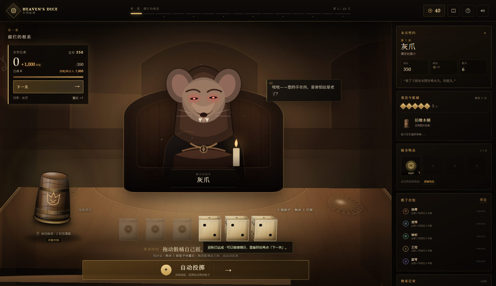
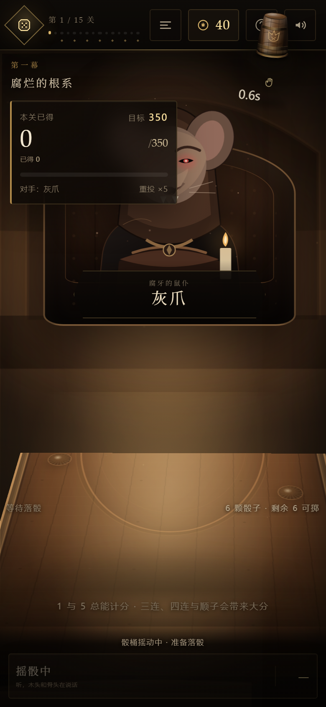
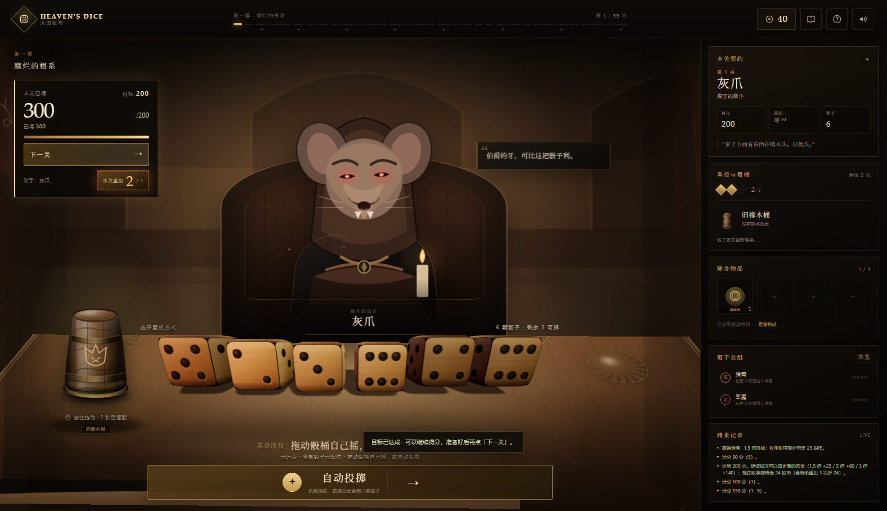
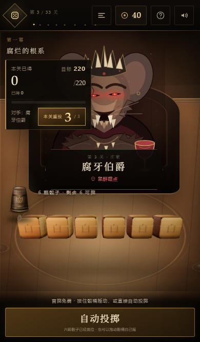
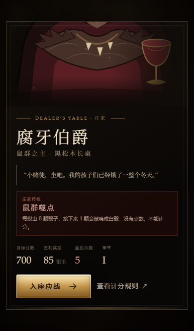

# 天国骰局 · Heaven's Dice

> 骰子落下之前，命运只是一句空话。

一款以《天国：拯救 2》骰子规则为骨架的**肉鸽网页游戏**。你坐在长桌这一侧，用六颗骰子、三次重投和一件件不太干净的赌具，去够到每关的目标分数；3、7、11、15、20、24 关会从稀有/史诗/传说池中各抽一位庄家，每局开始时就定下路线；第 25 关是最终庄家撒旦。二十五关，五张桌子，十四位庄家——赢下他们，天就亮了。

项目采用 **Vite + TypeScript** 分层架构：`src/core` 规则引擎、`src/content` 内容注册表、`src/render` WebGL/GSAP 渲染、`src/ui` 界面组装。生产发布先执行 `npm run build`，只部署 `dist/`；GSAP 与 three.js 均从本地 vendor 加载，所有插画与图标都是仓库内的原创 SVG。

源码仓库：`git@github.com:fangzipei/heaven-s-dice.git`


## 线上地址

- 当前发布：<http://221.228.10.210:9999/heavens-dice/>
- 健康检查：<http://221.228.10.210:9999/heavens-dice/healthz>
- 发布与更新说明：[deploy/README.md](deploy/README.md)

这台服务器的 80/443 在阿里云安全组未放行，所以先挂在已放行的 9999 端口独立路径下，不改动同端口原有站点。80 端口的 Nginx 站点也已配置好；在安全组放行 80/TCP 后，可直接访问裸 IP。

## 首页与图鉴

首页只保留主题图、logo、三个按钮和底部小字声明：

- **开始游戏**：先询问是否进入图解教程，然后入座。
- **查看图鉴**：骰子、骰桶、物品、赌桌、庄家与小兵。
- **查看规则**：打开完整的图解教程。


手机端首页：


### 图鉴解锁

物品、骰桶和骰子只有在**局内或市集中遇见过**之后才会显示名称、插画、概率与说明：

- 开局后解锁当前骰袋、当前骰桶和随身物品。
- 市集里刷新出来的货品，即使没有购买，只要出现过就会解锁。
- 解锁记录保存在浏览器 `localStorage`，跨局、刷新页面后仍然保留。
- 未遇见的条目只显示锁定占位，不显示名称、属性或概率。

| 未遇见 | 已解锁 |
|---|---|
|  |  |

## 图解教程

点击「开始游戏」会先询问是否进入教程，也可以从首页「查看规则」直接打开。

教程用骰子图逐条解释：

- 单颗 1 / 5 的计分；
- 三个相同点数（三条）的基础分，例如 **三个 3 = 300**；
- 四个、五个、六个相同点数的倍率，例如 **四个 3 = 600（300 × 2）**、五个 3 = 1,200、六个 3 = 2,400；
- 1 点的特例、顺子、混合组合与“选中骰必须全部合法”；
- 已得 / 本轮未计入、掷空作废、全骰、达标后手动下一关；
- 骰桶、36 枚秘骰、套组、物品、市集和庄家池的桌规。

| 开局询问 | 计分图解 |
|---|---|
|  |  |

手机端教程（390px 宽）：


| 对局 · 3D 场景 | 3D 骰子特写 |
|---|---|
|  |  |
| **骰桶倒扣** | **重投前慢转** |
|  |  |
| **已得 / 本轮未计入** | **计分后准备续投** |
|  |  |
| **掷空作废** | **目标达成后继续得分** |
|  |  |
| **骰桶全桌拖动** | **五芒星仪式** |
|  |  |
| **桌面五芒星轨迹** | **桌面顺时针圆轨迹** |
|  |  |
| **计分后单按钮续投** | **手机全界面摇桶** |
|  |  |
| **全类型悬浮详情** | **醒目重投计数** |
|  |  |
| **手机庄家就绪** | **手机庄家开场** |
|  |  |
| **进入下一关的银币明细** | **赌徒图鉴** |
|  |  |
| **市集** | **终局赌桌** |
|  |  |
| **庄家登场** | **手机庄家开场** |
|  |  |

线上运行：


手机端选中骰子后的计分按钮（固定在底部安全区上方）：


---

## 3D 场景

对局场景不是一张预先画好的平面背景：

- 房间的后墙、侧墙、地面、桌面和对手座椅都由 **CSS 3D transforms** 组成，带有真实透视与深度排序。
- 鼠标在场景内移动时，房间与桌面会产生很轻的**视差摆动**；对手、骰桶和骰子随之位移，UI 保持稳定。
- 按住骰桶摇动后，骰子会**持续追着当前骰桶的位置**飞过去，缩到零后消失；即使一边拖一边收骰，也不会在旧位置留下缩小骰子。收骰完成即开始 **2 秒倒计时**；松手后骰子从**释放时的骰桶位置**出现并放大飞回桌面，倒计时结束或提前松手都会落骰。
- 装备五芒桶或旋涡桶时，按住骰桶会在桌面上显示金色轨迹（五芒星 / 顺时针圆）；沿着轨迹拖动骰桶描画，轨迹覆盖率或方向偏差过大时仪式失败，但仍会正常落骰。
- 选骰高亮：选中骰子会抬高、金色描边、底座光晕并亮起右上角 ✓，未选骰子自动退暗；托盘上方同步显示“已选 N 颗”。
- 骰子是真正的**六面立方体**：每个面都有独立点数，落定时结果面朝向镜头；投掷时整颗骰子翻滚。
- 点数是标准骰子布局：**2 点与 3 点斜向排列**，4 点四角，5 点四角加中心，6 点两列。三点不会再排成一条直线。
- 桌面材质通过主题变量切换，木头、青石、黑铁、黄金、钻石各自有不同色阶、纹理和桌面光。

---

## 快速开始

环境：Node.js 20+。

```bash
# 在项目根目录
npm run dev
# 打开 http://127.0.0.1:4173
```

也可以直接使用任意静态服务器托管项目根目录。不能双击 `index.html` 打开，因为项目使用了 ES Modules，浏览器会拦截 `file://` 下的模块加载。

运行测试：

```bash
npm test
```

平衡模拟：

```bash
npm run simulate      # 500 局全流程模拟
node tools/balance.mjs 400
```

骰子期望分数评估（单颗 / 2 件 / 4 件 / 配桶的关卡得分期望差，含商店出货分布）：

```bash
npm run dice:ev
node tools/dice-ev.mjs --trials=600 --level=8
```

---

## 玩法

- **目标**：第 1 关 **500 分**，第 2 关 **1000 分**；2–7 关每关 +15%，第 8 关在 7 关基础上 +500，8–10 关每关 +15%；11–15 关每关 +12%；第 16 关加 1000，16–24 关每关 +13%；第 24 关约 **30060 分**，第 25 关撒旦固定 **100000 分**。7 关后的普通庄家目标额外 +10%，撒旦不受该加成影响。达到目标后不会自动结束，可以继续得分；准备好后点击左上角「下一关」，再进入市集或结局。
- **银币**：开局 **0 银币**，只能靠过关和出售物品积累。
- **骰子**：默认 6 颗，每关基础 3 次重投；击败庄家不会累积上限，烈酒 / 时间沙漏 / 加注契约 / 旋涡桶仪式可以临时 +1。第一次投掷免费。每次落骰后整桌骰子的左右顺序都会重新打乱，点数跟着骰子走。
- **流程**：投掷 → 点击选择要计分的骰子 → 选择：
  1. **计分并继续**：选中骰计分并移出，免费重投剩余骰子，**不消耗重投**；
  2. **计分并重投**：选中骰计分并移出，全部六颗骰子重新投，消耗 1 次重投。
- **计分后不自动重投**：计分动作结算完成后会停在“准备续投”，不会替玩家自动掷下一次。此时可以拖动骰桶自己摇，或点下方唯一的「自动投掷」按钮让系统代摇。
- **轮次定义**：一轮由多次「计分并继续」组成。每次继续都把分数累加进本轮挂账，仍处于风险中；只有点击「计分并重投」才会结束本轮，把累计分全部落袋，再开始新一轮。若中间某次投掷没有任何可计分组合，本轮累计分全部清零，已落袋的分数保留；**下一次重投会把全部骰子放回桌上**，包括本轮先前已经计分、放在一边的骰子。左上角会拆开显示“已得 / 本轮未计入”。
- **全骰（Hot Dice）**：六颗骰子全部计分会免费重投全部骰子，但**不会结束本轮**；本轮累计分仍处于风险中，直到点击「计分并重投」。
- **重投计数**：计分面板右下角的大号「本关重投 剩余 / 上限」显示整关剩余重投；低于 2 次变橙，耗尽变红，不随轮次重置。
- **无重投次数**：仍可免费「计分并继续」，也可以「计分并结算」；全部重投不可用。
- **失败与魔鬼交易**：掷空且没有未用重投、也没有可用物品时，若银币足够，可以付钱让魔鬼重启本关；第一次 100、第二次 1000、第三次 10000 银币。保留骰袋、骰桶与物品，本关分数从 0 开始。魔鬼的收据可以清空重来次数，让下一次重新从 100 开始。
- **重投**：每关基础 3 次；徽记不再累积，少数庄家会减少，烈酒 / 时间沙漏 / 加注契约 / 旋涡桶仪式可临时 +1。
- **门房赠礼**：开局自带一枚主动物品「幸运币」，立即 +250 分，一次性消耗。

### 过关奖金：收手换钱与超额赏金

结算发生在点击「下一关」的那一刻，所以“什么时候收手”本身是一笔账。

| 来源 | 规则 |
|---|---|
| 基础奖励 | 每关固定值（55 ~ 440 银币，见关卡表） |
| 未用重投 | 每剩 **1 次未使用的重投 = 基础奖励的 20%** |
| 超额赏金 | 得分**严格超过目标 2 倍**，额外奖励 **基础奖励的 50%**；刚好 2 倍不算 |
| 镀金袖扣 | 每关胜利 +15（被动物品，可与上面叠加） |

- 开局银币为 **0**，第一关目标 **500 分**；第 2 关起按 `500 × 1.05^(关-1) × 2` 增长，庄家再乘自己的目标系数。
- 结算明细写进 `levelReward.bonuses`，胜利面板逐条列出；进入下一关关闭开场介绍时，左上角银币旁会弹出**本关收入明细**，包含基础赏金、未用重投和 2 倍超额奖励。
- 左上角「胜利奖励」实时等于**此刻收手的总收入**（基础 + 未用重投 + 是否超过 2 倍），悬停可看明细。
- 公式常量在 `src/content/meta.ts`：`REROLL_BONUS_RATE = 0.2`、`OVERSHOOT_RATIO = 2`、`OVERSHOOT_BONUS_RATE = 0.5`；`cashOutValue(state)` 同时供预览和结算使用。

### 历史骰局

首页「历史骰局」会按结束时间倒序列出已结算的局：

- 是否通关 / 失败 / 弃局
- 结束日期与具体时间
- 本局实际游玩耗时
- 最终银币与得分
- 最终关卡
- 通关时持有的骰子（按数量合并）、骰桶、主动物品、被动物品

无密码本地用户读取 `heavensDice.history.v2`；已同步账号会再合并服务器 `/history` 返回的云端记录，单机失败时自动回退到本地记录。

### 存档、玩家 ID 与统计

- 对局中的完整状态会自动写入 localStorage（`heavensDice.save.v2`），首页出现「继续上局」；页面刷新、关闭后都能从原关卡、原分数、原选骰状态继续。
- 第一次开局先填玩家 ID：服务器检查该 ID 是否已存在。不存在则创建无密码本地账号并占住 ID；已存在则要求输入密码登录。之后右上方头像可随时补密码并同步。
- **密码留空 = 本地用户**（ID 已在服务器占位）；**每局结束后都会自动上传一次**。填写密码后升级为同步账号，可在其他设备登录并合并历史。
- 注册 ID 全局唯一；无密码账号也占位，换设备无法凭 ID 找回，需在原设备头像里设置密码。
- 通关/死亡时写入一条完整历程：总用时（只算实际游玩时间）、每关目标/得分/装备、每次投掷的骰面与选择、计分组合、每次商店刷新/买入/卖出/离开。
- 数据表为 `hd_users`、`hd_sessions`、`hd_runs`、`hd_run_levels`、`hd_shop_choices`。API 提供 `time`（最快通关）与 `luck`（霉运指数）排行榜，以及按骰子/骰桶/物品聚合的强度统计。
- 本地历史在 `heavensDice.history.v2`；网络失败会进入待同步队列，下次设置密码或打开页面时重试。

### 计分规则（《天国：拯救 2》/ Farkle）

三个及以上相同点数统称**条子**：三个相同是**三条**，四个是**四条**，五个是**五条**，六个是**六条**。

| 组合 | 分数 |
|---|---:|
| 单颗 1 | 100 |
| 单颗 5 | 50 |
| 三条 1 | 1000 |
| 三条 2–6 | 点数 × 100 |
| 四条 | 三条 × 2 |
| 五条 | 三条 × 4 |
| 六条 | 三条 × 8 |
| 顺子 1–2–3–4–5 | 500 |
| 顺子 2–3–4–5–6 | 750 |
| 天地顺 1–6 | 1500 |

一次计分必须把所选的每一颗骰子都纳入合法组合。1 与 5 可以单颗计分；其他点数至少三颗。系统会在合法拆分中自动取最高分。

每次「计分并继续」都累加进“本轮未计入”；下一次投掷即使仍能计分，也不会提前落袋。只有「计分并重投」结束本轮并把累计分落袋，或者掷空让本轮累计全部作废。已得分数不会因后来的掷空回退。**掷空后的下一次重投会把全部骰子放回桌上**，包括本轮先前已经计分、放在一边的骰子。

---

## 操作

| 操作 | 方式 |
|---|---|
| 手动摇骰 | 按住骰桶拖动；骰子追当前桶位缩小消失，松手从释放位置放大落桌；2 秒倒计时后自动落骰 |
| 仪式轨迹 | 五芒桶 / 旋涡桶按住后显示桌面轨迹，沿轨迹画；偏差过大则仪式失败 |
| 呼吸灯 | 可以手动摇骰时，骰桶会持续发出金色呼吸光 |
| 手机端计分 | 选中骰子后，底部安全区上方固定出现「计分并继续 / 计分并重投」两个按钮 |
| 自动投掷 | 点击下方「自动投掷」或按空格 |
| 悬浮详情 | 悬浮任意骰子、物品、骰桶或对应卡牌，显示名称、稀有度、效果、概率与说明 |
| 选择骰子 | 点击骰子；可多选 |
| 计分并继续 | 底部左侧按钮 / 数字键 `1`（重投剩余骰子） |
| 计分并重投 | 底部右侧按钮 / 数字键 `2`（全部六颗重新投） |
| 计分并结算 | 无重投次数时出现的单一按钮（也可按 `1`） |
| 使用物品 | 右侧「随身物品」栏 |
| 查看详情 | 悬浮任意骰子、物品、骰桶或对应卡牌，显示名称、稀有度、效果、概率与说明 |
| 画阵 | 装备仪式骰桶后，也可点击「画阵」使用独立画布 |
| 关闭弹窗 | `Esc` 或右上角关闭 |

鼠标悬停在骰子上可以看到**当前骰桶修正后的六面概率**、稀有度、套组和骰子特性。

---

## 二十五关结构：三段百分比曲线

3、7、11、15、20、24 关固定是庄家关；每局开始时从对应稀有度池随机抽一位：3/7 稀有、11/15 史诗、20/24 传说，25 关固定撒旦。小兵空档为 2 / 3 / 3 / 3 / 4 / 3 / 0，25 关分五张桌子：
5 / 5 / 5 / 5 / 5。
无庄家目标曲线按复利增长：

- 第 1 关：500
- 第 2 关：1000
- 2–7 关：每关 **+15%**
- 第 8 关：在第 7 关基础上 **+500**
- 8–10 关：每关 **+15%**
- 11–15 关：每关 **+12%**
- 第 16 关：在第 15 关基础上 **+1000**
- 16–24 关：每关 **+13%**

庄家只把自己那一行乘上目标系数，例如第 3 关无庄家目标 1150，腐牙伯爵 ×1.15 后是 1320；第 4 关仍回到无庄家曲线 1320。完整 25 行表、商店稀有度与期望提升、旧 33 关庄家通过率见 [docs/level-curve.md](docs/level-curve.md)；可运行 `node tools/curve-model.mjs` 复核。

| 关卡数 | 无庄家目标 | 实际目标 | 基础赏金 | 庄家系数 |
|---|---|---|---|---|
| 24 | 500 → 18210 | 500 → 30060 | 55 → 450 | ×1.15 – ×1.50 |
| 25 | 500 → 100000 | 撒旦固定 100000 | 55 → 445 | ×1.00 |

每经过 7、15 关，背景会再暗一层，同时进入下一段更陡的曲线。目标与赏金仍由 `src/content/levels/curve.ts` 生成，庄家系数写在各自的 `curve` 里。

改完任何数值后跑一次：

```
node tools/balance.mjs 400
```

---

## 庄家池与特殊效果

每局开始时，3、7 关从稀有池、11、15 关从史诗池、20、24 关从传说池随机抽取，且同一池不重复。25 关固定为撒旦。稀有度越高，目标系数越高，赏金也越高；具体通过率见 [docs/level-curve.md](docs/level-curve.md)。

| 庄家 | 稀有度 | 目标系数 | 赏金系数 | 特殊效果 |
|---|---|---:|---:|---|
| **腐牙伯爵** · 鼠群之主 | 稀有 | ×1.15 | ×1.60 | 每投出 8 颗骰子，下一颗被啃成白骰。 |
| **石心审判官** · 无言法庭 | 稀有 | ×1.15 | ×1.60 | 本关重投次数减少 1 次。 |
| **双六赌徒** · 只认两头 | 稀有 | ×1.15 | ×1.60 | 单骰只允许 2 点或 6 点计分。 |
| **抽头鬼** · 按骰收税 | 稀有 | ×1.15 | ×1.60 | 每颗参与计分的骰子扣 2 银币。 |
| **铁面铸魂师** · 熔炉之主 | 史诗 | ×1.20 | ×1.85 | 所有 5 点骰子被熔毁。 |
| **灰烬书记官** · 熔炉的记录员 | 史诗 | ×0.80 | ×1.85 | 不能连续使用同一种骰型。 |
| **金冠赌王** · 无冕之王 | 史诗 | ×0.80 | ×1.85 | 第一次计分锁定骰型，之后只能用同型。 |
| **悬秤人** · 未落定之数 | 史诗 | ×1.20 | ×1.85 | 本关所有得分都是漂浮分，掷空整桌清零。 |
| **双倍镜** · 另一个你 | 史诗 | ×1.20 | ×1.85 | 本关目标分 ×2。 |
| **成双之忌** · 不许成对 | 史诗 | ×0.80 | ×1.85 | 投掷出现对子时，整次投掷无法计分。 |
| **星辉税吏** · 天穹的收税官 | 传说 | ×1.50 | ×2.15 | 只有 3 颗及以上的组合才能计分。 |
| **钻石天使** · 最后的庄家 | 传说 | ×1.50 | ×2.15 | 所有计分减少 40%。 |
| **路西法** · 晨星 | 传说 | ×1.50 | ×2.15 | 每次投掷随机封禁一种骰型，三条/四条/五条/六条分别计算。 |
| **撒旦** · 天堂的主人 | 传说 | ×1.00 | ×2.00 | 第 25 关固定出现；目标 100000，开局 +2 重投。 |

灰烬、金冠、成双的目标系数为 ×0.80；史诗庄家多为 ×1.20，传说庄家为 ×1.50；撒旦固定第 25 关、目标 100000。普通庄家首次击败会掉落一件**专属传说物品**，这些物品不会进入商店。五个小兵样式分别对应五张桌子的章节：鼠仆「灰爪」、石像鬼「石砾」、熔炉学徒「炭手」、鎏金侍从、棱翼执事。

| 庄家 | 专属掉落 | 效果 |
|---|---|---|
| 腐牙伯爵 | 鼠牙王冠 | 每次投掷 5% 概率使本次计分 +10% |
| 石心审判官 | 停审令牌 | 「计分并重投」25% 概率不扣重投，每关一次 |
| 双六赌徒 | 双六骨 | 单骰改为 2/6 计分，分值 200/100；1/5 不再单计 |
| 抽头鬼 | 抽头账簿 | 单次计分含 3 颗以上骰子时 +10 银币 |
| 铁面铸魂师 | 熔炉余烬 | 5 点不再被熔；计分中的 5 点每个 +25 分 |
| 灰烬书记官 | 复写灰烬 | 每种骰型每关第一次计分 +25% |
| 金冠赌王 | 无冕金冠 | 最常用骰型计分 +20% |
| 悬秤人 | 悬秤砣 | 漂浮分掷空保留 50%，每关一次 |
| 双倍镜 | 双倍镜片 | 超过目标分保留至下一关，最多 800 |
| 星辉税吏 | 三证铜印 | 3 颗以上组合 +25% |
| 钻石天使 | 天使羽 | 总得分 +10% |
| 路西法 | 晨星角 | 每关第一次被封禁骰型仍可计分 |
| 成双之忌 | 连理骨 | 两颗同点组成对子，分数为三条的一半 |

---

## 五张桌子

| 章节 | 桌子 | 材质 | 视觉语言 |
|---|---|---|---|
| I | 黑松木长桌 | 橡木 | 树脂、刀痕、鼠洞、暖色烛火 |
| II | 灰岩审判桌 | 青石 | 石板、裂缝、苔藓、冷蓝色光 |
| III | 熔铁赌桌 | 黑铁 | 铆钉、铁板、熔金裂纹、锻炉火星 |
| IV | 鎏金王庭桌 | 黄金 | 金箔、藤蔓纹、红丝绒、金币 |
| V | 棱晶天穹桌 | 钻石 | 悬浮晶面、星图、冷白棱光 |

五张桌子在游戏内会随关卡自动切换；在「赌徒图鉴 → 赌桌」中也可以查看完整画廊。

---

## 骰子：36 枚秘骰 + 标准骰

**四套各 4 枚**：狼裔、恶魔、星轨、商旅；套组骰整局各只能获取一枚，其余 **20 枚无套组**，走极端骰型、顺序互动与商店成长。稀有度分布：普通 11、稀有 9、史诗 10、传说 6；普通骰也可能带一条明确的计分规则。

### 套组效果

| 套组 | 主题 | 2 件 | 4 件 |
|---|---|---|---|
| **狼裔** | 群狼咬住 **3** | 每颗计分的 3 额外 +80 分 | 计分含三条 3 时额外 +800 分 |
| **恶魔** | 掷出 1 = **恶魔赖子** | 计分用上了赖子时 ×1.18 | 计分用上了赖子时 ×1.35（替代 2 件） |
| **星轨** | 不同点数连成星盘 | 计分含 2 种以上不同点数时 +350 | 每关第一次重投免费，且本次计分 ×1.10 |
| **商旅** | 路费、货价与利息 | 每次成功计分额外 +50 银币 | 每局第一次魔鬼重来免费 |

**恶魔赖子规则**：恶魔套骰子掷出 1 时不会记作 100 分，而是变成赖子「魔」。赖子可以补进三条／更大的同点组合（该点数必须至少有一颗自然骰），也可以补顺子缺口（**每个缺口用 1 颗赖子，几张缺口就能用几颗**；所以 1-2-3-4 + 2 颗赖子 = 天地顺）；顺子已经完整时，赖子还能顶替其中一面，把那一面的自然骰解放出来单独计分。赖子**不能单独计分**，也不能用来凑单颗 1 / 5 的分数。未被用上的赖子会让整手计分不成立。

### 秘骰一览

| 稀有度 | 名称 | 套组 | 售价 | 概率偏向 | 特性 |
|---|---|---|---:|---|---|
| 稀有 | 小恶魔骰 | 恶魔 | 70 | 恶魔赖子 13%，其余面均衡。 | — |
| 普通 | 乳狼骰 | 狼裔 | 35 | 3 点 23%，1 约 19%、5 约 18%，中间点数薄。 | — |
| 普通 | 拾级骰 | 星轨 | 35 | 概率沿 1→6 缓缓递增，5、6 各 22%。 | — |
| 史诗 | 税吏骰 | 恶魔 | 130 | 恶魔赖子 14%，5、6 略高。 | — |
| 稀有 | 血月骰 | 狼裔 | 70 | 3 点概率 36%，1 约 19%、5 约 21%。 | — |
| 稀有 | 照面骰 | 星轨 | 70 | 1、6 各 25%，2、5 各 20%，3、4 各 5%。 | — |
| 稀有 | 孤影骰 | 星轨 | 70 | 只有 1、3、5 三种点数（各 1/3），永远不会掷出双数。 | — |
| 稀有 | 阴阳骰 | 无套组 | 70 | 只有 1 和 6（30% / 70%）。 | — |
| 传说 | 无冠女王 | 恶魔 | 210 | 恶魔赖子 14%；计分含此骰 ×1.18，场上但未选中 ×0.94。 | 恶魔契约：含此骰 ×1.18；不含则 ×0.94 |
| 史诗 | 白狼王骰 | 狼裔 | 130 | 3 点 33%；计分含至少一颗 3 时 +260。 | 狼王：计分含至少一颗 3 时 +260 |
| 史诗 | 回声骰 | 无套组 | 130 | 六面均衡；计分含此骰时，本次计分 ×1.14。 | 回声：计分含此骰时 ×1.14 |
| 史诗 | 双生骰 | 星轨 | 130 | 只有 2、4、6（22% / 18% / 60%）；单颗不能计分，是纯组合骰，但三条极好凑。计分含任意三条时 +520。 | 双生：计分含任意三条时 +520 |
| 史诗 | 五福骰 | 无套组 | 130 | 5 点概率 36%；此骰以 5 计分时 +50。 | 五福：此骰以 5 计分时 +50 |
| 史诗 | 六合骰 | 无套组 | 130 | 5、6 各 28% / 30%；计分同时含 5 与 6 时 +300。 | 六合：计分同时含 5 与 6 时 +300 |
| 传说 | 噬名者 | 恶魔 | 210 | 恶魔赖子 20%；此骰作为赖子计分时 +140。 | 噬名：此骰作为恶魔赖子计分时 +140 |
| 传说 | 狼祖骰 | 狼裔 | 210 | 3 点概率 37%；计分含至少一颗 3 时 +520。 | 狼祖：计分含至少一颗 3 时 +520 |
| 传说 | 双煞骰 | 无套组 | 210 | 1、5 各 30%；此骰以 1 计分时 +120。 | 双煞：此骰以 1 计分时 +120 |
| 传说 | 骰王 | 无套组 | 210 | 六面完全均衡；计分含任意三条时 +340（靠组合吃饭，不靠点数偏好）。 | 骰王：计分含任意三条时 +340 |
| 稀有 | 衡心骰 | 商旅 | 70 | 六面均衡；此骰参与计分时 +180。 | 衡心：此骰计分 +180 |
| 普通 | 孤崖骰 | 无套组 | 35 | 1、5 各 5%，其余四面对半分（各 22.5%）；此骰计分 +400。 | 孤崖：此骰计分 +400 |
| 传说 | 重奏骰 | 无套组 | 210 | 六面均衡；按条子（三条及以上）计分时额外结算一次。 | 重奏：条子额外结算一次 |
| 普通 | 浮面骰 | 无套组 | 35 | 每关开始时随机重排六面概率。 | 浮面：每关随机六面概率 |
| 史诗 | 商旅骰 | 商旅 | 130 | 六面均衡；初始额外 +0.6 倍分数（+60%），每店一次重随后永久再 +15%。 | 商旅：初始 +0.6 倍，重随成长 |
| 普通 | 金痕骰 | 商旅 | 35 | 六面均衡；每次计分挂 30 银币，锁分时入账。 | 金痕：计分挂 30 银币 |
| 普通 | 末路骰 | 商旅 | 35 | 六面均衡；本关没有重投次数时计分 ×1.5。 | 末路：无重投 ×1.5 |
| 史诗 | 随影骰 | 无套组 | 130 | 六面均衡；落骰后复制桌面第一颗骰子的点数（自己排第一时失效）。 | 随影：复制第一颗 |
| 史诗 | 邻行骰 | 无套组 | 130 | 六面均衡；50% 概率变成前一颗骰子的相邻点数（±1）。 | 邻行：贴邻前一颗 |
| 稀有 | 连记骰 | 无套组 | 150 | 六面均衡；此骰每成功参与一次非浮动计分，之后它再参与计分就永久 +60（可叠加）。 | 连记：每次参与计分后此骰 +60 |
| 普通 | 拾荒骰 | 无套组 | 35 | 六面均衡；此骰参与计分时 +280。 | 拾荒：此骰计分 +280 |
| 史诗 | 余响骰 | 无套组 | 130 | 六面均衡；每次参与计分后，之后每一手永久 +80（可叠加）。 | 余响：每次参与计分后 +80 |
| 普通 | 壹面骰 | 无套组 | 35 | 1 点 30%，其余五面各 14%。 | — |
| 普通 | 贰面骰 | 无套组 | 35 | 2 点 38%，其余五面各 12.4%。 | — |
| 普通 | 叁面骰 | 无套组 | 35 | 3 点 38%，其余五面各 12.4%。 | — |
| 普通 | 肆面骰 | 无套组 | 35 | 4 点 38%，其余五面各 12.4%。 | — |
| 普通 | 伍面骰 | 无套组 | 35 | 5 点 30%，其余五面各 14%。 | — |
| 普通 | 陆面骰 | 无套组 | 35 | 6 点 30%，其余五面各 14%。 | — |

> 骰子的概率是真实的六面权重，会在**当前骰桶的修正后**显示在悬停提示里。商店会优先提供与你已有套组同门的骰子，方便凑 2 / 4 件套。
>
> 每枚骰子都有独立概率，因此用 `npm run dice:ev` 做蒙特卡洛评估：同一关、同一贪心策略下，只替换一颗骰子（或凑 3 颗、或换上配套的骰桶），比较关卡得分期望的差值。报告按稀有度带给出中位 Δ，并单独列出「组合骰」（单颗无收益、三颗才有爆发，例如双生骰）。评估结果同时统计各等级段商店的稀有度出货分布。

---

## 骰桶：19 只（初始 + 概率 + 骰型 + 落骰互动 + 仪式 + 经济/防爆）

| 骰桶 | 类型 | 效果 |
|---|---|---|
| 旧橡木桶 | 初始 | **无偏修正**，均衡的起点 |
| 铅心桶 | 概率 | 1、5 出现率提高 |
| 蛇纹桶 | 概率 | 2、3、4 提高，1 降低 |
| 星象桶 | 概率 | 5、6 提高 |
| 狼图腾桶 | 点数加成 | 每颗参与计分的 3 +50 分；含三条 3 再 +150 分 |
| 恶魔契桶 | 赖子加成 | 每颗参与计分的恶魔赖子 +60 分 |
| 鎏金桶 | 染金 | 10% 概率让一颗骰子染金；该骰计分时 +100 银币 |
| 定一桶 | 定点 | 10% 概率指定一颗骰子为 1 |
| 顺遂桶 | 补顺 | 35% 概率把一颗骰子转成缺少的点数，补成顺子 |
| 增殖桶 | 增殖 | 5% 概率多滚出一颗临时骰 |
| 独注桶 | 单骰加成 | 本轮此前都只按单颗骰型计分时，本次 +20% |
| 五芒桶 | 仪式 | 画完五芒星，本掷所有计分 +20%（每关只能生效一次） |
| 旋涡桶 | 仪式 | 顺时针画满一圈，本掷 +15%，每关 +1 重投（每关一次） |
| 当铺桶 | 经济 | 每 10 银币让本手 +1 分，单次最多 +80 |
| 守夜桶 | 防爆 | 每关第一次掷空保留本轮 50% 挂账分 |
| 引信桶 | 物品联动 | 使用主动物品后，下一次计分 +120 |
| 轮转桶 | 重投 | 每次重投后随机一颗未计分骰子点数 +1 |
| 双面桶 | 选面 | 每关开始选择两个点数，大幅提高这两面概率 |
| 借运桶 | 经济防爆 | 每关第一次掷空可付 40 银币重投 |

骰型加成桶只奖励**真正被选入本次计分**的骰型：狼图腾桶付钱给计分里的 3，恶魔契桶付钱给真正补进组合的赖子（赖子不能单独计分，所以空转的赖子一分不给），鼓励围绕一套骰子组构筑。

仪式支持两种入口：按住骰桶直接在桌面描画（2 秒倒计时，偏差过大失败），或点击「画阵」打开独立画布。画阵失败可以重画，不消耗资源。

---

## 物品：43 件 = 15 主动 + 28 被动（其中 10 件一次性，13 件庄家专属）

主动物品每关恢复 1 次，默认最多同时携带 **3 件**；被动物品永久生效。**夹层行囊**（史诗被动）再增加 1 个主动物品格。**庄家专属物品**只在首次击败对应庄家时掉落，全部为传说品质，不会出现在商店。**一次性消耗品**用完即消失，但同价位下效果更直接。只有改变骰子数量的两件（`+1`/`-1`）是唯一物品，整局各只能获取一次；其他物品在出售或消耗后可以再次进货。

| 类型 | 名称 | 稀有度 | 售价 | 效果 |
|---|---|---|---:|---|
| 一次性 | 幸运粉 | 普通 | 40 | 免费重掷所有未计分骰子，并立即获得 150 分；已经计分的骰子留在桌上。一次性消耗。 |
| 一次性 | 烈酒 | 普通 | 35 | 本关 +1 次重投。一次性消耗，喝完就没了。 |
| 一次性 | 加注契约 | 稀有 | 85 | 本关 +1 次重投，且下一次计分 ×1.6。一次性消耗。 |
| 一次性 | 盐 | 史诗 | 105 | 掷空时会询问是否使用：用掉后本轮未计入的分数转为已得。一次性消耗。 |
| 一次性 | 幸运币 | 普通 | 35 | 立即获得 250 分。一次性消耗。 |
| 一次性 | 猎人印记 | 稀有 | 75 | 本关下一次计分翻倍。一次性消耗。 |
| 一次性 | 静默赦令 | 传说 | 260 | 消除下一次遇到的庄家被动。在庄家关首掷前使用可当场消除；一次性消耗。 |
| 一次性 | 魔鬼的收据 | 史诗 | 444 | 清空本局的重来次数；下一次与魔鬼交易重新从 100 银币开始。一次性消耗。 |
| 一次性 | 史诗骰匣 | 史诗 | 140 | 随机获得 1 枚史诗骰子。一次性消耗。 |
| 一次性 | 双择骰函 | 稀有 | 90 | 随机出现 2 枚稀有骰子，选择其中 1 枚。一次性消耗。 |
| 一次性 | 魔术手套 | 普通 | 35 | 将当前选中的一颗骰子改为 1 点。一次性消耗。 |
| 主动 | 烟雾弹 | 史诗 | 200 | 免费重掷所有未计分骰子，不消耗重投次数；已经计分的骰子留在桌上。 |
| 主动 | 赌徒护符 | 史诗 | 120 | 本关目标分数降低 15%。 |
| 主动 | 时间沙漏 | 史诗 | 135 | 恢复 1 次重投，并立即获得 200 分。 |
| 主动 | 血契 | 传说 | 190 | 本关后续每次计分 +35%，但每次计分后失去 100 分。 |
| 被动 | 镀金袖扣 | 普通 | 50 | 每关胜利额外获得 15 银币，商店刷新费用 -20%。 |
| 被动 | 双孔桶架 | 稀有 | 170 | 商店骰桶货位 +1（默认 1 → 2）。 |
| 被动 | 裂痕骰袋 | 史诗 | 130 | 可使用的骰子 -1，购买时自行选择丢弃一颗；所有计分 +25%（永久，整局限获取一次）。 |
| 被动 | 暗格货架 | 史诗 | 190 | 商店物品货位 +1（默认 3 → 4）。 |
| 被动 | 三层骰架 | 史诗 | 200 | 商店骰子货位 +1（默认 2 → 3）。 |
| 被动 | 夹层行囊 | 史诗 | 190 | 可同时携带的主动物品 +1（默认 3 → 4）。 |
| 被动 | 丰饶骰袋 | 史诗 | 240 | 可使用的骰子 +1（永久，整局限获取一次）；第七位骰子参与计分时，其对应分数 -50%。 |
| 被动 | 三环坠 | 稀有 | 100 | 三条的得分 +15%。 |
| 被动 | 顺风铃 | 史诗 | 180 | 顺子的得分 +12%。 |
| 被动 | 四方印 | 史诗 | 160 | 四条的得分 +20%。 |
| 被动 | 五指扣 | 史诗 | 170 | 五条的得分 +25%。 |
| 被动 | 六芒冠 | 传说 | 280 | 六条的得分 +50%。 |
| 被动 | 天地盘 | 传说 | 300 | 天地顺的得分 +20%。 |
| 被动 | 点金符 | 史诗 | 140 | 一点或五点的得分 +10%。 |

三件「货架」被动分别给市集某一区 +1 个上架数量：**三层骰架**（骰子 2 → 3）、**双孔桶架**（骰桶 1 → 2）、**暗格货架**（物品 3 → 4）；**夹层行囊**给主动物品栏 +1。

静默赦令使用后会把下一次遇到的庄家被动整个抹掉；如果已经在庄家关，只要还没投第一掷，也可以当场抹掉：


---

## 市集

每关结束后进入「行商帐篷」：

- **骰子区**：默认 2 枚，首次刷新 20 银币；**三层骰架** +1。
- **骰桶区**：默认 1 只，首次刷新 26 银币；**双孔桶架** +1。
- **物品区**：默认 3 件，首次刷新 22 银币；**暗格货架** +1。
- 三个分区的货位都由 `Engine.shopSlots(run)` 统一给出，界面副标题也会实时跟着变（“货架 3 枚（含 +1）”）。
- 同一分区每刷新一次，下一次价格 **×2**（翻倍）；切换分区不重置累计次数。镀金袖扣让刷新费用 −20%。
- 骰子货架按**等级阶段加权**：等级越高，史诗／传说越容易出现；恶魔骰在同等稀有度中只有其他骰子的 **50%** 权重。
- 主动物品默认最多同时携带 **3 件**；**夹层行囊** +1，达到上限后商店按钮显示“主动已满”。

| 等级 | 普通 | 稀有 | 史诗 | 传说 |
|---|---:|---:|---:|---:|
| ≤ 6 | 65% | 27% | 7% | 1% |
| ≤ 12 | 46% | 34% | 16% | 4% |
| ≤ 18 | 28% | 34% | 29% | 9% |
| ≤ 24 | 15% | 32% | 43% | 10% |

价格是一条刻意拉开的阶梯：骰子标价 **35 / 70 / 130 / 210**（普通→传说），骰桶 **70 – 330**，物品 **35 – 300**；最近一次平衡又把所有商店货品在标价基础上统一 **×1.25**。稀有度越高，每枚银币买到的 Δ 越少——贵的那部分买的是构筑上限，不是单点收益。

已拥有该套组的骰子额外 ×1.5 权重，方便凑 2 / 4 件套。用 `npm run dice:ev` 可以核对各等级段的实际出货分布。
- 骰袋满 6 枚（或被动后 7 枚）时购入新骰会弹出替换选择；换下来的骰子直接回池。
- 已拥有的秘骰和骰桶不会再出现在货架上；非唯一物品在出售或消耗后可以重新进货，唯一物品不会。
- 出售随身物品不会改动当前货架；刷新时才按新的背包状态重新抽货。
- 改变骰子数量的被动（丰饶骰袋、裂痕骰袋）整局记录一次：即使刷新到也不会二次出售。
- **随身物品半价回收**：市集下方会列出自己拥有的主动/被动物品，按基础价格的一半出售；出售后立即移除效果并增加银币。
- **静默赦令**是全表最贵的一次性物品（260 银币），使用后从行囊消失；消除下一场庄家被动，或在庄家关首掷前当场消除。
- 一次性消耗品用掉后会重新进入货池，可以再买；唯一物品（丰饶骰袋、裂痕骰袋）不会。
- 丰饶骰袋在骰袋已满 7 颗时不能出售，避免挤掉已有骰子；裂痕骰袋出售后会补回骰子容量。


---

## 项目结构

```text
.
├─ index.html                  # 单页入口、内联 SVG 图标库
├─ css/main.css                # 视觉系统、场景、骰子、商店、响应式
├─ src/
│  ├─ content/                # 关卡曲线、35 骰、13 桶、27 物品、8 庄家
│  ├─ core/                   # 计分、引擎、事件与领域类型
│  ├─ render/                 # CSS/WebGL 骰桌、骰皮与动效
│  ├─ ui/                     # 对局、市集、图鉴、教程与 HUD
│  └─ platform/               # 存档、账号、音效与调试桥
├─ assets/
│  ├─ rooms/                   # 5 张 3D 场景的后墙纹理
│  ├─ tables/                  # 5 张桌子图鉴缩略图（1600×1000 SVG）
│  ├─ portraits/               # 5 小兵 + 8 庄家（600×760 SVG）
│  ├─ cups/                    # 19 只骰桶（240×300 SVG）
│  └─ items/                   # 27 枚物品图标（120×120 SVG）
├─ tools/
│  ├─ generate_scene_art.py    # 房间/桌子/骰桶/物品 SVG 生成器
│  ├─ generate_portraits.py    # 10 张角色 SVG 生成器
│  ├─ balance.mjs              # 全流程平衡模拟
│  └─ *-test.mjs               # CDP 浏览器验收脚本
├─ docs/screenshots/           # README 展示图
├─ tests/
│  ├─ unit/                    # vitest：规则、内容注册表与各屏渲染契约
│  └─ helpers/                 # 桩 DOM 与旧入口探针
└─ vite.config.js              # Vite 开发/构建配置
```

### 美术

- 所有场景与角色都是手工参数化的原创 SVG，没有使用生成式图片服务或第三方美术。
- 对局场景用 CSS 3D 构成空间；`tools/generate_scene_art.py` 生成五张章节后墙纹理、桌子图鉴缩略图、骰桶和物品图标；角色由 `tools/generate_portraits.py` 生成。
- 骰子用 CSS 六面立方体而不是贴图平面，正面始终按标准骰子点数布局呈现投掷结果。
- 重新生成：

```bash
python tools/generate_scene_art.py   # 房间后墙、桌子缩略图、骰桶、物品
python tools/generate_portraits.py   # 10 张角色画像
```

- 动效：骰子落下、全骰爆闪、计分漂浮、桌子切换、卡片悬浮、商店换页、仪式轨迹；支持 `prefers-reduced-motion`。
- 音效：Web Audio 实时合成（骰子碰撞、计分、仪式、胜负），无音频文件依赖，可开关并记住偏好。

---

## 更新日志

首页的「更新日志」和游戏里的日志弹窗都由 [src/content/changelog.ts](src/content/changelog.ts) 驱动。

**以后每次发版都在数组最上面加一条**，首页会自动显示最新一条，不需要改 `index.html`：

```ts
{
  date: '2026-10-29',
  title: '一句话标题',
  summary: '一句话告诉玩家这次最值得注意的变化。',
  items: [
    '这里写玩家能感知到的变化，不要写函数名、文件名或实现细节。',
  ],
}
```

写法约定：用玩家听得懂的话；先说多了什么/改了什么，再说对自己有什么影响；每次发版至少更新一条；平衡和 Bug 修复也要写。

## 工程取舍

- **没有引入框架**：游戏状态集中在 `src/core/engine.ts`，UI 仅做展示与动画。这样可以用 Node 直接测试规则，也方便用浏览器 CDP 验证交互。
- **计分采用穷举**：单次最多 7 颗骰子，2⁷ 个子集，暴力搜索最优合法拆分完全够用；牺牲微秒级性能换取规则清晰。
- **随机数可注入**：`createRun({ rng })` 支持种子 RNG，便于测试与复现。
- **无后端**：所有进度在当前页面内存中；声音偏好写入 localStorage。页面刷新会开始新的一局。
- **难度**：第 2 关起所有目标分翻倍，旧的 500 次自动模拟通关率（约 0.6%）已不再适用，需重新跑平衡模拟标定；风险仍来自本轮分数在掷空时会作废。
- **动态难度**：开局会请求 `GET /config`，读取 `hd_game_config.difficulty_multiplier`（总系数）与 `level_targets`（分关目标，JSON 对象，键为关卡号）。分关目标优先，其余关卡按总系数缩放并取整到 10。改数据库后下一局生效。

---

## 验收

```bash
npm test                                  # vitest：规则/引擎/内容注册表/各屏渲染契约
npm run dice:ev                           # 骰子期望分蒙特卡洛（稀有权重带 + 组合骰）
node tools/balance.mjs 400                # 24 关贪心 bot 模拟：到达率 / 本关通过率 / 终局余钱
node tools/build-codex.mjs                # 重建 docs/codex.html 全图鉴
node tools/flow-test.mjs                  # 物品、商店、骰袋替换、五芒星
node tools/reroll-test.mjs                # 继续=同一轮；重投=落袋并开始新一轮
node tools/round-test.mjs                 # 连续继续累加、重投落袋、掷空清零与重投 HUD
node tools/cup-anim-test.mjs               # 手动入骰、倒扣、落骰
node tools/cup-range-test.mjs               # 骰桶可拖遍整个界面
node tools/spin-test.mjs                   # 重投前六骰慢转
node tools/bust-test.mjs                   # 掷空后本轮分数作废
node tools/next-level-test.mjs             # 达标后继续得分，手动下一关
node tools/mobile-select-test.mjs          # 手机端选中后的两个计分按钮
node tools/mobile-boss-test.mjs            # 手机端庄家开场、开始按钮与就绪状态
node tools/tutorial-test.mjs               # 开局询问 + 教程图解 + 从教程开局
node tools/codex-test.mjs                  # 首页三按钮 + 图鉴锁定/市集解锁/持久化
node tools/boss-test.mjs                   # 庄家池的白骰、禁六、牌型限制、计分税与禁重投
node tools/shop-sell-test.mjs              # 市集随身物品半价出售
node tools/cup-trace-test.mjs              # 骰桶 2 秒倒计时与桌面仪式轨迹
node tools/cup-ui-test.mjs                 # 单按钮续投、全界面摇桶与手机布局
node tools/tooltip-test.mjs                # 骰子/物品/骰桶在局内、市集、图鉴的悬浮详情
node tools/mobile-boss-test.mjs            # 手机端庄家开场、开始按钮与就绪状态
node tools/round-test.mjs                  # 连续继续累加、重投落袋、掷空清零与重投 HUD
npm run build                              # Vite 生产构建到 dist/

node tools/interaction-test.mjs           # 手动摇桶、旋涡绘制、响应式
node tools/final-check.mjs                # 悬停概率、图鉴、Boss 抽成
node tools/campaign-test.mjs              # 真实 UI 连打 24 关、庄家徽记、终局
node tools/responsive-test.mjs            # 平板/手机/笔记本断点
node tools/capture-final.mjs              # 重新生成 docs/screenshots
```

浏览器验收使用本机 Microsoft Edge 的 CDP 无头模式；测试脚本会把过程截图写到 `tools/` 作为本地检查记录，不需要随生产部署。`docs/screenshots` 中的展示图由 `capture-final.mjs`、`cup-anim-test.mjs`、`cup-range-test.mjs`、`spin-test.mjs`、`bust-test.mjs`、`next-level-test.mjs`、`mobile-select-test.mjs`、`tutorial-test.mjs`、`codex-test.mjs`、`boss-test.mjs`、`shop-sell-test.mjs`、`cup-trace-test.mjs`、`cup-ui-test.mjs`、`tooltip-test.mjs`、`mobile-boss-test.mjs` 与 `round-test.mjs` 生成。

---

## 来源与致谢

- 骰子计分规则遵循《天国：拯救 2》的 Farkle 计分表（单骰、三/四/五/六条、短顺、天地顺）。
- 世界观、角色、文案、数值、美术均为本项目原创；「天国：拯救」相关名称仅用于说明规则来源。
