# 天国骰局 · Heaven's Dice

> 骰子落下之前，命运只是一句空话。

一款以《天国：拯救 2》骰子规则为骨架的**肉鸽网页游戏**。你坐在长桌这一侧，用六颗骰子、五次重投和一件件不太干净的赌具，去够到每关的目标分数；每三关，桌子对面会从一名小兵换成一位庄家。十五关，五张桌子，五位庄家——赢下他们，天就亮了。

项目为**原生 HTML / CSS / JavaScript**，无框架、无构建步骤、无外部运行时依赖；所有插画与图标都是仓库内的原创 SVG。

源码仓库：`git@github.com:fangzipei/heaven-s-dice.git`

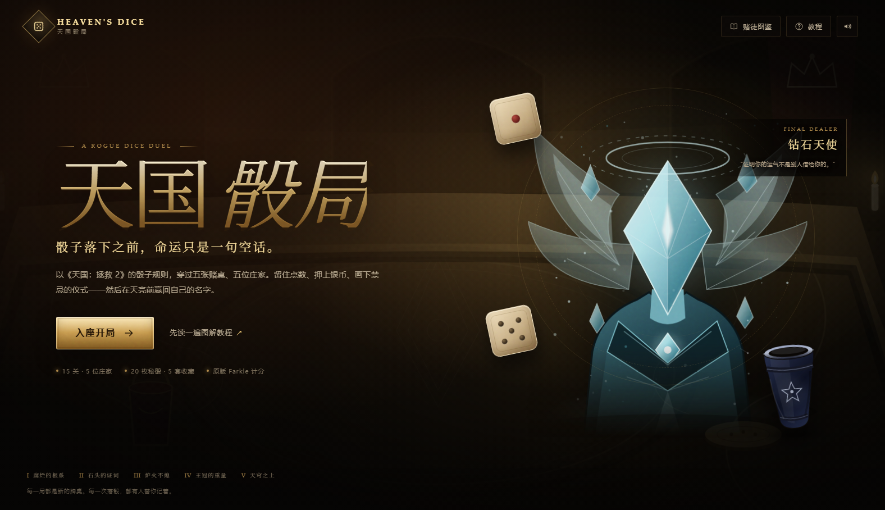

## 线上地址

- 当前发布：<http://221.228.10.210:9999/heavens-dice/>
- 健康检查：<http://221.228.10.210:9999/heavens-dice/healthz>
- 发布与更新说明：[deploy/README.md](deploy/README.md)

这台服务器的 80/443 在阿里云安全组未放行，所以先挂在已放行的 9999 端口独立路径下，不改动同端口原有站点。80 端口的 Nginx 站点也已配置好；在安全组放行 80/TCP 后，可直接访问裸 IP。

## 开局教程

点击「入座开局」会先询问是否进入教程，也可以从开始页的「教程」或「先读一遍图解教程」直接打开。

教程用骰子图逐条解释：

- 单颗 1 / 5 的计分；
- 三个相同点数（三连）的基础分，例如 **三个 3 = 300**；
- 四个、五个、六个相同点数的倍率，例如 **四个 3 = 600（300 × 2）**、五个 3 = 1,200、六个 3 = 2,400；
- 1 点的特例、顺子、混合组合与“选中骰必须全部合法”；
- 已得 / 本轮未计入、掷空作废、全骰、达标后手动下一关；
- 骰桶、20 枚秘骰、套组、物品、市集和五位庄家的桌规。

| 开局询问 | 计分图解 |
|---|---|
| 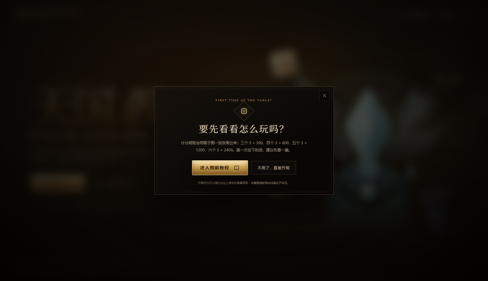 | 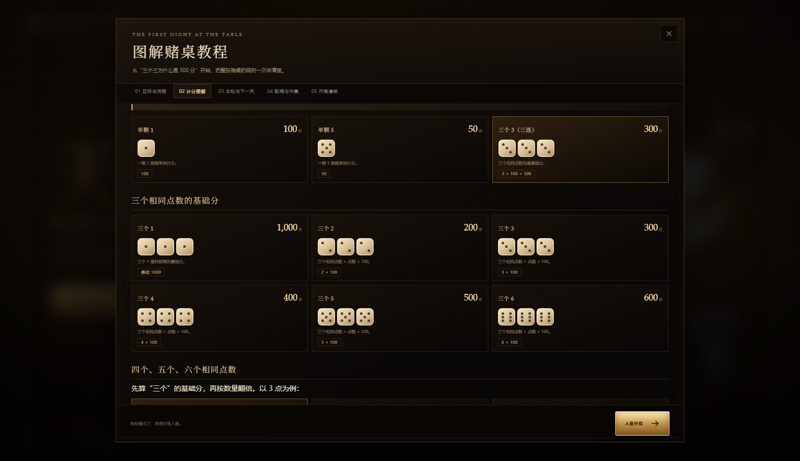 |

手机端教程（390px 宽）：

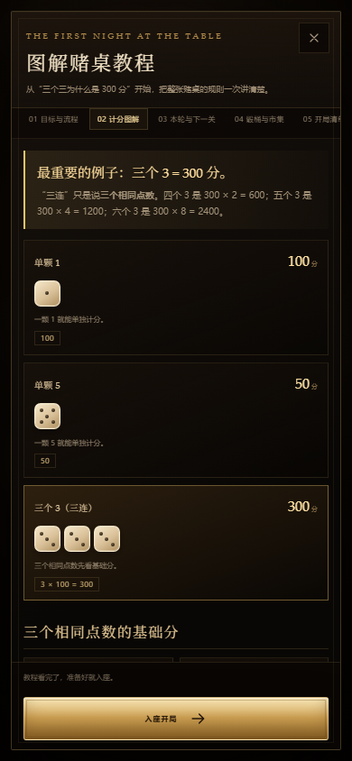

| 对局 · 3D 场景 | 3D 骰子特写 |
|---|---|
| 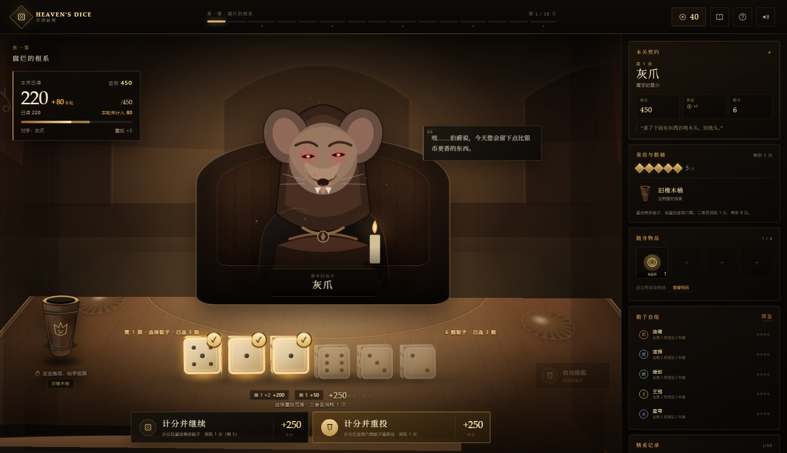 | 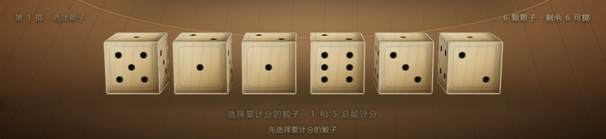 |
| **骰桶倒扣** | **重投前慢转** |
| 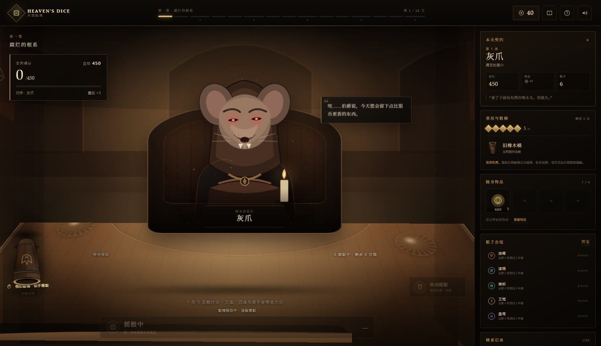 | 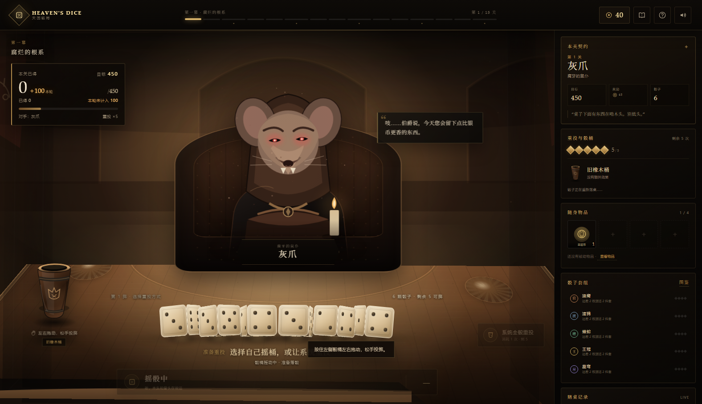 |
| **已得 / 本轮未计入** | **计分后选择重投方式** |
| 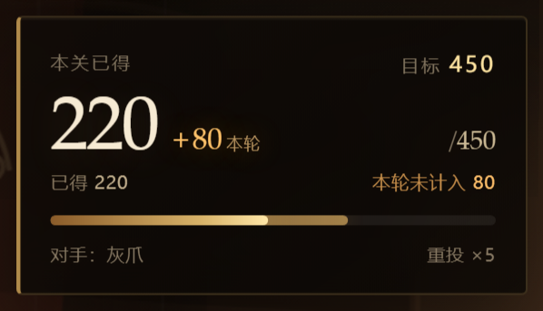 | 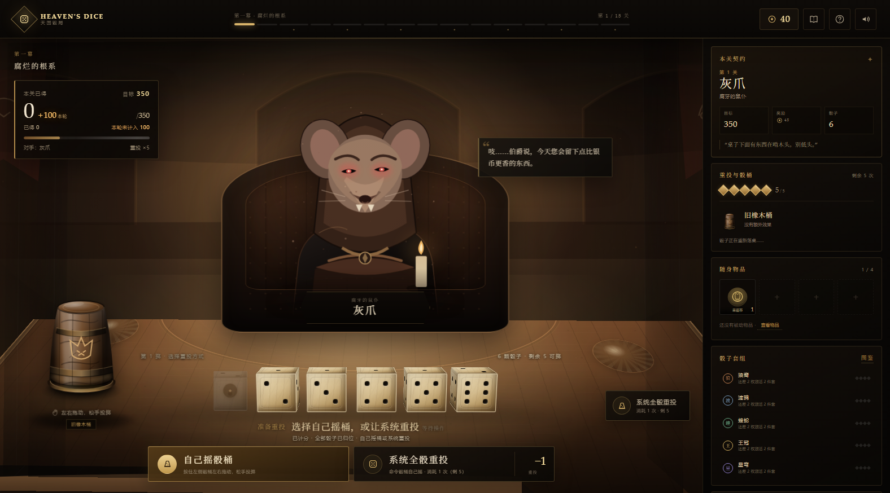 |
| **掷空作废** | **目标达成后继续得分** |
| 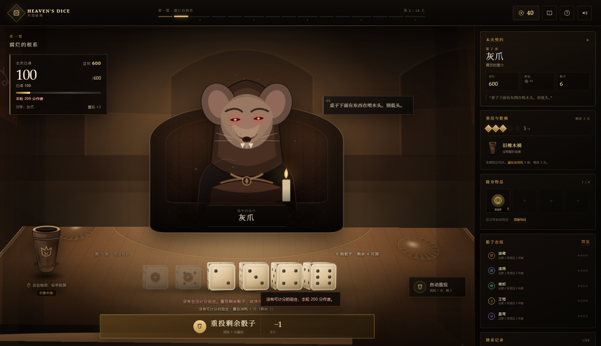 | 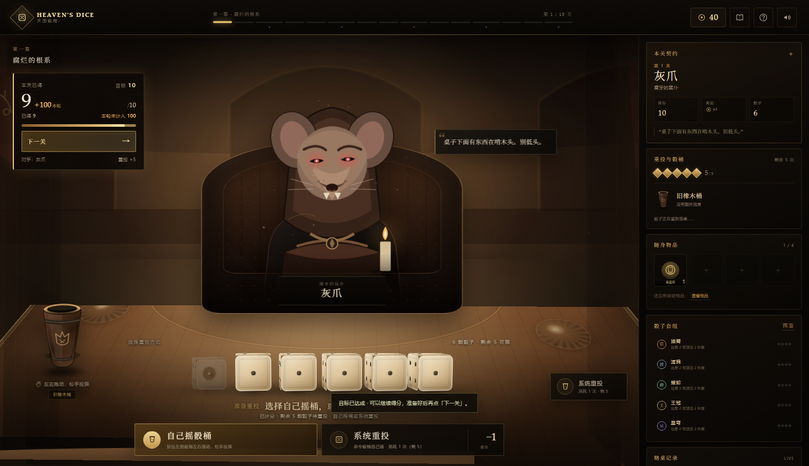 |
| **骰桶全桌拖动** | **五芒星仪式** |
|  | 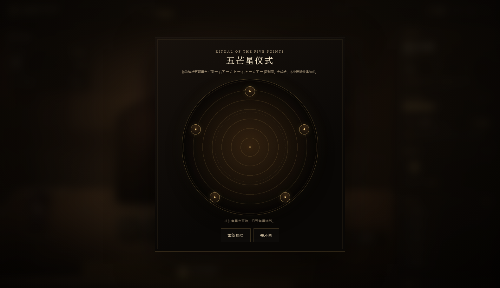 |
| **赌徒图鉴** | **市集** |
| 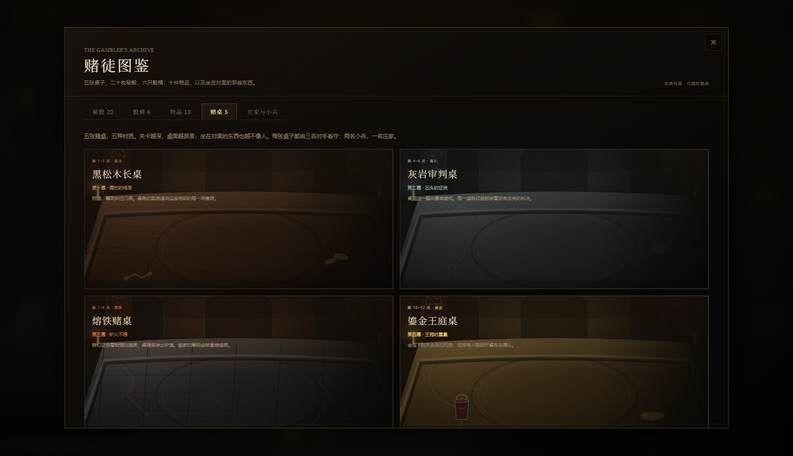 | 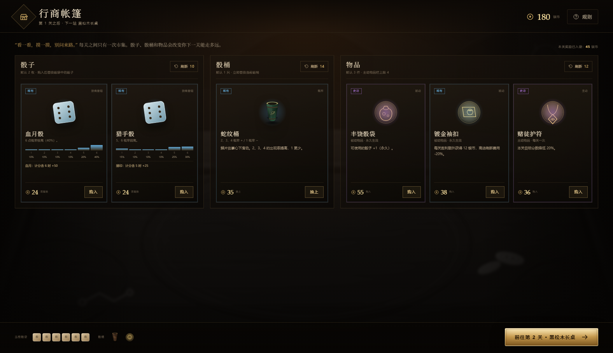 |
| **终局赌桌** | **庄家登场** |
| 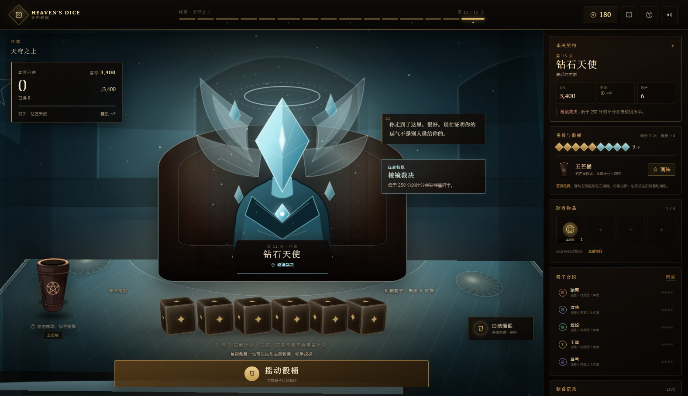 | 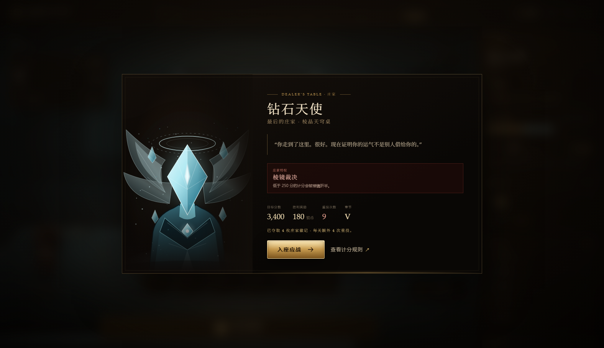 |

线上运行：

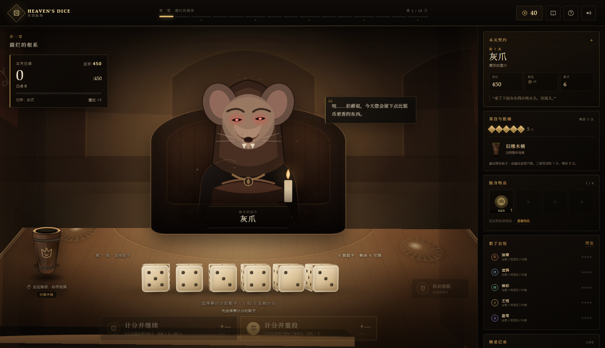

手机端选中骰子后的计分按钮（固定在底部安全区上方）：

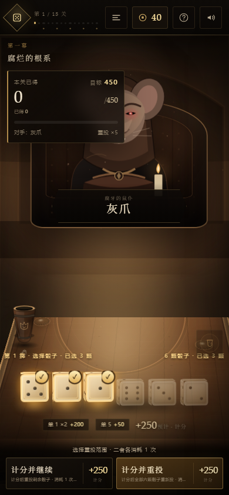

---

## 3D 场景

对局场景不是一张预先画好的平面背景：

- 房间的后墙、侧墙、地面、桌面和对手座椅都由 **CSS 3D transforms** 组成，带有真实透视与深度排序。
- 鼠标在场景内移动时，房间与桌面会产生很轻的**视差摆动**；对手、骰桶和骰子随之位移，UI 保持稳定。
- 重投前，桌上可读的骰子会先缓慢自转（全部重投时六颗一起转）；按住骰桶摇动后，骰子逐颗飞进桶里，桶身倒扣并持续抖动，松手后扶正、骰子落桌。
- 选骰高亮：选中骰子会抬高、金色描边、底座光晕并亮起右上角 ✓，未选骰子自动退暗；托盘上方同步显示“已选 N 颗”。
- 骰子是真正的**六面立方体**：每个面都有独立点数，落定时结果面朝向镜头；投掷时整颗骰子翻滚。
- 点数是标准骰子布局：**2 点与 3 点斜向排列**，4 点四角，5 点四角加中心，6 点两列。三点不会再排成一条直线。
- 桌面材质通过主题变量切换，木头、青石、黑铁、黄金、钻石各自有不同色阶、纹理和桌面光。

---

## 快速开始

环境：Node.js 20+。

```bash
# 在项目根目录
npm run dev
# 打开 http://127.0.0.1:4173
```

也可以直接使用任意静态服务器托管项目根目录。不能双击 `index.html` 打开，因为项目使用了 ES Modules，浏览器会拦截 `file://` 下的模块加载。

运行测试：

```bash
npm test
```

平衡模拟：

```bash
npm run simulate      # 500 局全流程模拟
node tools/balance.mjs 400
```

---

## 玩法

- **目标**：每关达到目标分数后不会自动结束，可以继续得分；准备好后点击左上角「下一关」（终局为「查看结局」），再进入市集或结局。共 15 关。
- **骰子**：默认 6 颗，默认 5 次重投。第一次投掷免费。
- **流程**：投掷 → 点击选择要计分的骰子 → 选择：
  1. **计分并继续**：选中骰计分并移出，重投剩余骰子；
  2. **计分并重投**：选中骰计分并移出，全部六颗骰子重新投。
  - 两种选择各消耗 1 次重投。
- **计分后不自动重投**：计分动作结算完成后会停在“选择重投方式”，不会替玩家自动掷下一次。此时可以拖动左侧骰桶自己摇，或点「系统重投」/右侧自动按钮让系统代摇。
- **本轮与掷空**：继续/重投得到的分数先进入“本轮未计入”池；下一次投掷若仍存在合法计分组合，这笔分数转为“已得”，若完全没有可计分组合，则本轮这笔分数全部作废，此前的“已得”保留。左上角会拆开显示“已得 / 本轮未计入”，掷空时给出红色作废提示。
- **全骰（Hot Dice）**：如果六颗骰子全部被计分，六颗骰子全部归位，可以免费重投全部骰子，不消耗重投次数；本轮分数仍然处于未计入状态。
- **无重投次数**：选择「计分并结算」；若已达到目标，可以继续停留或点击下一关，否则本关失败。
- **失败**：重投耗尽且分数仍不足目标，本关失败。可以**卷土重来**：保留骰袋、骰桶与物品，失去一半银币。
- **庄家徽记**：每击败一位庄家，后续关卡的重投上限永久 +1（基础仍是 5 次）。
- **门房赠礼**：开局自带一枚主动物品「幸运币」，每关可花费一次，立即 +150 分。

### 计分规则（《天国：拯救 2》/ Farkle）

| 组合 | 分数 |
|---|---:|
| 单颗 1 | 100 |
| 单颗 5 | 50 |
| 三连 1 | 1000 |
| 三连 2–6 | 点数 × 100 |
| 四连 | 三连 × 2 |
| 五连 | 三连 × 4 |
| 六连 | 三连 × 8 |
| 顺子 1–2–3–4–5 | 500 |
| 顺子 2–3–4–5–6 | 750 |
| 通天顺 1–6 | 1500 |

一次计分必须把所选的每一颗骰子都纳入合法组合。1 与 5 可以单颗计分；其他点数至少三颗。系统会在合法拆分中自动取最高分。

每次计分先挂入“本轮未计入”；下一次投掷若仍有合法计分组合，自动转入“已得”，若掷空则这笔挂账作废。已得分数不会因后来的掷空回退。

---

## 操作

| 操作 | 方式 |
|---|---|
| 手动摇骰 | 按住左侧骰桶拖动；拖动范围覆盖整张桌面，骰子入桶、桶倒扣后松手落骰 |
| 手机端计分 | 选中骰子后，底部安全区上方固定出现「计分并继续 / 计分并重投」两个按钮 |
| 自动摇骰 | 点击右侧「自动摇骰」或按空格 |
| 选择骰子 | 点击骰子；可多选 |
| 计分并继续 | 底部左侧按钮 / 数字键 `1`（重投剩余骰子） |
| 计分并重投 | 底部右侧按钮 / 数字键 `2`（全部六颗重新投） |
| 计分并结算 | 无重投次数时出现的单一按钮（也可按 `1`） |
| 使用物品 | 右侧「随身物品」栏 |
| 画阵 | 装备仪式骰桶后，点击「画阵」 |
| 关闭弹窗 | `Esc` 或右上角关闭 |

鼠标悬停在骰子上可以看到**当前骰桶修正后的六面概率**、稀有度、套组和骰子特性。

---

## 十五关结构

每三关一章。前两关是本章小兵，第三关是庄家。桌子的材质随章节改变。

| 关 | 目标 | 银币 | 对手 | 桌 | 备注 |
|---:|---:|---:|---|---|---|
| 1 | 450 | 45 | 灰爪（鼠仆） | 黑松木长桌 | 教学节奏 |
| 2 | 600 | 50 | 灰爪（鼠仆） | 黑松木长桌 | 第 2 次相遇 |
| 3 | 800 | 80 | **腐牙伯爵** | 黑松木长桌 | 鼠群分食 |
| 4 | 950 | 55 | 石砾（石像鬼） | 灰岩审判桌 | 石头材质 |
| 5 | 1100 | 60 | 石砾（石像鬼） | 灰岩审判桌 | |
| 6 | 1250 | 100 | **石心审判官** | 灰岩审判桌 | 石化凝视 |
| 7 | 1400 | 70 | 炭手（熔炉学徒） | 熔铁赌桌 | 铁桌 |
| 8 | 1550 | 75 | 炭手（熔炉学徒） | 熔铁赌桌 | |
| 9 | 1700 | 120 | **铁面铸魂师** | 熔铁赌桌 | 熔炉淬火 |
| 10 | 1900 | 80 | 鎏金侍从 | 鎏金王庭桌 | 金桌 |
| 11 | 2100 | 85 | 鎏金侍从 | 鎏金王庭桌 | |
| 12 | 2350 | 140 | **金冠赌王** | 鎏金王庭桌 | 庄家抽成 |
| 13 | 2600 | 95 | 棱翼执事 | 棱晶天穹桌 | 钻石桌 |
| 14 | 2900 | 110 | 棱翼执事 | 棱晶天穹桌 | |
| 15 | 3400 | 180 | **钻石天使** | 棱晶天穹桌 | 棱镜裁决 |

> 实测一局到后期，庄家徽记会把重投上限推高到 9 次；目标曲线与商店经济按“随机购物策略下通关率约 0.6%、熟练构筑可显著提高”的难度调过。失败可保留构筑重试，因此终局并非一次性赌博。

---

## 五位庄家与特殊效果

| 庄家 | 章节 | 特殊效果 | 机制 |
|---|---|---|---|
| **腐牙伯爵** · 鼠群之主 | 3 | 鼠群分食 | 每次计分被偷走 10% |
| **石心审判官** · 无言法庭 | 6 | 石化凝视 | 本关重投次数 −1 |
| **铁面铸魂师** · 熔炉之主 | 9 | 熔炉淬火 | 三连及以上与顺子的计分 −30% |
| **金冠赌王** · 无冕之王 | 12 | 庄家抽成 | 「计分并继续」的本次计分 −20% |
| **钻石天使** · 最后的庄家 | 15 | 棱镜裁决 | 低于 250 分的计分折半 |

五个小兵样式分别对应五位庄家的章节：鼠仆「灰爪」、石像鬼「石砾」、熔炉学徒「炭手」、鎏金侍从、棱翼执事。每个小兵都有自己的立绘、台词和章节氛围。

---

## 五张桌子

| 章节 | 桌子 | 材质 | 视觉语言 |
|---|---|---|---|
| I | 黑松木长桌 | 橡木 | 树脂、刀痕、鼠洞、暖色烛火 |
| II | 灰岩审判桌 | 青石 | 石板、裂缝、苔藓、冷蓝色光 |
| III | 熔铁赌桌 | 黑铁 | 铆钉、铁板、熔金裂纹、锻炉火星 |
| IV | 鎏金王庭桌 | 黄金 | 金箔、藤蔓纹、红丝绒、金币 |
| V | 棱晶天穹桌 | 钻石 | 悬浮晶面、星图、冷白棱光 |

五张桌子在游戏内会随关卡自动切换；在「赌徒图鉴 → 赌桌」中也可以查看完整画廊。

---

## 骰子：20 枚秘骰 + 标准骰

五套套组，每套 4 枚。装备 2 枚 / 4 枚触发套组效果。稀有度分布严格为：普通 2、稀有 10、史诗 5、传说 3。

### 套组效果

| 套组 | 2 件 | 4 件 |
|---|---|---|
| **狼裔** | 每颗计分的 6 +25 分 | 含三连/顺子的计分额外 +100 |
| **渡鸦** | 每关 +1 次重投 | 每颗计分的 1 +50 分 |
| **蝰蛇** | 顺子额外 +250 | 每颗计分的 5 +50 分 |
| **王冠** | 商店价格 −15% | 每关胜利额外 +12 银币 |
| **星穹** | 每关目标 −10% | 所有计分 +15% |

### 秘骰一览

| 稀有度 | 名称 | 套组 | 概率偏向 | 特性 |
|---|---|---|---|---|
| 普通 | 乳狼骰 | 狼裔 | 1/6 各 20% | — |
| 普通 | 渡鸦羽 | 渡鸦 | 1 点 30% | — |
| 稀有 | 猎手骰 | 狼裔 | 5/6 偏高 | 计分含 5 时 +25 |
| 稀有 | 血月骰 | 狼裔 | 6 点 40% | 计分含 6 时 +50 |
| 稀有 | 夜瞳骰 | 渡鸦 | 1/5 偏高 | 计分含 1 时 +50 |
| 稀有 | 告死骰 | 渡鸦 | 6 点 40% | 计分含 6 时 +30 |
| 稀有 | 蛇鳞骰 | 蝰蛇 | 2/5 偏高 | — |
| 稀有 | 毒牙骰 | 蝰蛇 | 5 点 35% | 计分含 5 时 +50 |
| 稀有 | 王庭骰 | 王冠 | 5/6 略高 | — |
| 稀有 | 税吏骰 | 王冠 | 1 点 35% | 计分含 1 时 +25 |
| 稀有 | 星尘骰 | 星穹 | 3/4/6 略高 | — |
| 稀有 | 彗尾骰 | 星穹 | 3/4 偏高 | 计分含顺子时 +75 |
| 史诗 | 白狼王骰 | 狼裔 | 6 点 35% | 计分含两颗 6 时 +150 |
| 史诗 | 千目渡鸦 | 渡鸦 | 1 点 40% | 计分含 1 时 +75 |
| 史诗 | 九头蛇之牙 | 蝰蛇 | 2/3/4/5 偏高 | 计分含顺子时 +200 |
| 史诗 | 王之金玺 | 王冠 | 5/6 各 30% | 同时含 5 与 6 时 +100 |
| 史诗 | 星核骰 | 星穹 | 6 点 30% | 计分含 6 时 +50 |
| 传说 | 噬星之蛇 | 蝰蛇 | 2/3/5 各 25% | 计分含此骰时 ×1.15 |
| 传说 | 无冠女王（恶魔骰） | 王冠 | 1/5 各 30% | 含此骰 ×1.25；场上但未选中 ×0.85 |
| 传说 | 命运之眼 | 星穹 | 1/2 各 25% | 每关首次计分含此骰时 +1 重投 |

> 骰子的概率是真实的六面权重，会在**当前骰桶的修正后**显示在悬停提示里。商店会优先提供与你已有套组同门的骰子，方便凑 2/4 件套。

---

## 骰桶：6 只（初始 + 3 概率 + 2 仪式）

| 骰桶 | 类型 | 效果 |
|---|---|---|
| 旧橡木桶 | 初始 | **无偏修正**，均衡的起点 |
| 铅心桶 | 概率 | 1、5 出现率提高 |
| 蛇纹桶 | 概率 | 2、3、4 提高，1 降低 |
| 星象桶 | 概率 | 5、6 提高 |
| 五芒桶 | 仪式 | 画完五芒星，本掷所有计分 +25% |
| 旋涡桶 | 仪式 | 顺时针画满一圈，本掷 +10%，每关 +1 重投（每关一次） |

仪式通过 Canvas 轨迹识别：五芒星必须依次穿过五颗星点，旋涡必须顺时针画满至少约 288° 且保持在一个圆环内。画阵失败可以重画，不消耗资源。

---

## 物品：10 件 = 8 主动 + 2 被动

主动物品每关恢复 1 次，最多携带 4 件；被动物品永久生效。

| 类型 | 名称 | 效果 |
|---|---|---|
| 主动 | 幸运币 | +150 分（开局赠送） |
| 主动 | 烈酒 | 本关 +2 次重投 |
| 主动 | 猎人印记 | 下一次计分 ×2 |
| 主动 | 魔术手套 | 把选中的一颗骰子改成 6 |
| 主动 | 烟雾弹 | 免费重投未计分骰子，不消耗重投 |
| 主动 | 赌徒护符 | 本关目标 −20% |
| 主动 | 时间沙漏 | +1 重投、+100 分 |
| 主动 | 血契 | 后续计分 +30%，但每次计分后 −30 分 |
| 被动 | 丰饶骰袋 | 可用骰子 +1（第 7 颗） |
| 被动 | 镀金袖扣 | 每关胜利 +12 银币，刷新费用 −20% |

---

## 市集

每关结束后进入「行商帐篷」：

- **骰子区**：默认 2 件，刷新 10 银币。
- **骰桶区**：默认 1 件，刷新 14 银币。
- **物品区**：默认 3 件，刷新 12 银币。
- 王冠 2 件套让所有商品价格 −15%；镀金袖扣让刷新费用 −20%。
- 骰袋满 6 枚（或被动后 7 枚）时购入新骰会弹出替换选择。
- 物品不重复出售；已拥有的秘骰和骰桶不会再出现在货架上。

---

## 项目结构

```text
.
├─ index.html                  # 单页入口、内联 SVG 图标库
├─ css/main.css                # 视觉系统、场景、骰子、商店、响应式
├─ src/
│  ├─ data.js                  # 15 关、20 骰、6 桶、10 物品、5 桌、10 对手
│  ├─ scoring.js               # KCD2 / Farkle 计分与最高合法组合搜索
│  ├─ engine.js                # 纯游戏状态：投掷、计分、商店、Boss、物品、仪式
│  └─ app.js                   # UI 渲染、动画、Canvas 仪式、音效、交互
├─ assets/
│  ├─ rooms/                   # 5 张 3D 场景的后墙纹理
│  ├─ tables/                  # 5 张桌子图鉴缩略图（1600×1000 SVG）
│  ├─ portraits/               # 5 小兵 + 5 庄家（600×760 SVG）
│  ├─ cups/                    # 6 只骰桶（240×300 SVG）
│  └─ items/                   # 10 枚物品图标（120×120 SVG）
├─ tools/
│  ├─ generate_scene_art.py    # 房间/桌子/骰桶/物品 SVG 生成器
│  ├─ generate_portraits.py    # 10 张角色 SVG 生成器
│  ├─ balance.mjs              # 全流程平衡模拟
│  └─ *-test.mjs               # CDP 浏览器验收脚本
├─ docs/screenshots/           # README 展示图
├─ tests/
│  ├─ scoring.test.mjs
│  └─ engine.test.mjs
└─ server.js                   # 无依赖静态服务器
```

### 美术

- 所有场景与角色都是手工参数化的原创 SVG，没有使用生成式图片服务或第三方美术。
- 对局场景用 CSS 3D 构成空间；`tools/generate_scene_art.py` 生成五张章节后墙纹理、桌子图鉴缩略图、骰桶和物品图标；角色由 `tools/generate_portraits.py` 生成。
- 骰子用 CSS 六面立方体而不是贴图平面，正面始终按标准骰子点数布局呈现投掷结果。
- 重新生成：

```bash
python tools/generate_scene_art.py   # 房间后墙、桌子缩略图、骰桶、物品
python tools/generate_portraits.py   # 10 张角色画像
```

- 动效：骰子落下、全骰爆闪、计分漂浮、桌子切换、卡片悬浮、商店换页、仪式轨迹；支持 `prefers-reduced-motion`。
- 音效：Web Audio 实时合成（骰子碰撞、计分、仪式、胜负），无音频文件依赖，可开关并记住偏好。

---

## 工程取舍

- **没有引入框架**：游戏状态集中在 `engine.js`，UI 仅做展示与动画。这样可以用 Node 直接测试规则，也方便用浏览器 CDP 验证交互。
- **计分采用穷举**：单次最多 7 颗骰子，2⁷ 个子集，暴力搜索最优合法拆分完全够用；牺牲微秒级性能换取规则清晰。
- **随机数可注入**：`createRun({ rng })` 支持种子 RNG，便于测试与复现。
- **无后端**：所有进度在当前页面内存中；声音偏好写入 localStorage。页面刷新会开始新的一局。
- **难度**：以 500 次自动模拟（含随机购物、随机对手、Boss 效果与徽记）做初版平衡，随机策略通关率约 0.6%；风险来自本轮分数在掷空时会作废。熟练玩家可通过套组、仪式和物品把通关率显著抬高。

---

## 验收

```bash
npm test                                  # 31 项规则/引擎/内容测试
node tools/flow-test.mjs                  # 物品、商店、骰袋替换、五芒星
node tools/reroll-test.mjs                # 继续=重投剩余；重投=全部六颗
node tools/cup-anim-test.mjs               # 手动入骰、倒扣、落骰
node tools/cup-range-test.mjs               # 骰桶可拖遍整张桌面
node tools/spin-test.mjs                   # 重投前六骰慢转
node tools/bust-test.mjs                   # 掷空后本轮分数作废
node tools/next-level-test.mjs             # 达标后继续得分，手动下一关
node tools/mobile-select-test.mjs          # 手机端选中后的两个计分按钮
node tools/tutorial-test.mjs               # 开局询问 + 教程图解 + 从教程开局
node tools/interaction-test.mjs           # 手动摇桶、旋涡绘制、响应式
node tools/final-check.mjs                # 悬停概率、图鉴、Boss 抽成
node tools/campaign-test.mjs              # 真实 UI 连打 15 关、Boss 徽记、终局
node tools/responsive-test.mjs            # 平板/手机/笔记本断点
node tools/capture-final.mjs              # 重新生成 docs/screenshots
```

浏览器验收使用本机 Microsoft Edge 的 CDP 无头模式；测试脚本会把过程截图写到 `tools/` 作为本地检查记录，不需要随生产部署。`docs/screenshots` 中的展示图由 `capture-final.mjs`、`cup-anim-test.mjs`、`cup-range-test.mjs`、`spin-test.mjs`、`bust-test.mjs`、`next-level-test.mjs`、`mobile-select-test.mjs` 与 `tutorial-test.mjs` 生成。

---

## 来源与致谢

- 骰子计分规则遵循《天国：拯救 2》的 Farkle 计分表（单骰、三/四/五/六连、短顺、通天顺）。
- 世界观、角色、文案、数值、美术均为本项目原创；「天国：拯救」相关名称仅用于说明规则来源。
